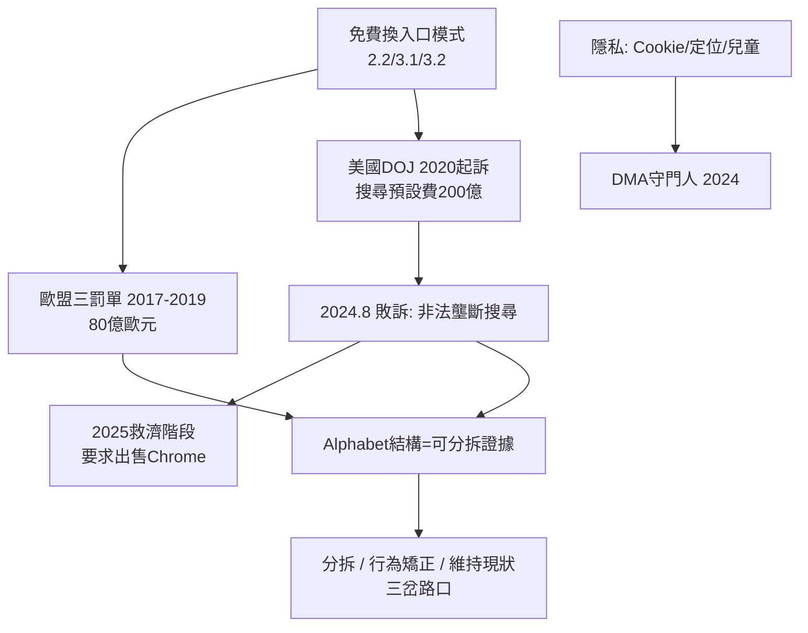

# 5.2 反壟斷與監管風暴（2010-至今）

Google 的法庭日曆比它的產品發布日曆更滿。歐盟最早開火：2017–2019 年，歐盟委員會以購物比價、Android 預裝、AdSense 排他為由，開出三張合計超過 80 億歐元的罰單，確立了「預裝 = 濫用支配地位」的法理。美國接棒：2020 年 10 月司法部起訴 Google 搜尋壟斷（支付蘋果每年上百億美元成為 Safari 預設搜尋），2023–2024 年兩案開庭——搜尋案與廣告技術案雙線作戰。2024 年 8 月，哥倫比亞特區法官裁定 Google 非法壟斷通用搜尋市場，這是自 1998 年微軟案以來美國科技反壟斷最重要的判決；2025 年進入救濟階段，司法部甚至要求強制出售 Chrome。

監管的邏輯直指 Google 商業模式的心臟。2.2 的品質分數競價、3.2 的「免費 Android 換預裝」、3.1 的「免費產品換資料」，在法官眼中是同一件事：**用一個市場的支配力（搜尋/系統）槓桿另一個市場（瀏覽器/廣告/地圖）**。蘋果每年收到的預設搜尋費（2022 年估計約 200 億美元）成為呈堂證供——「最好的產品」是否還需要花 200 億買預設位置？隱私戰線同時失火：第三方 Cookie 退役一再跳票（2020 宣布、2024 撤回），YouTube 的兒童隱私、定位紀錄追蹤各付出上億美元和解；歐盟《數位市場法》（DMA，2024 生效）直接把 Google 列為「守門人」，強制開放預設選項與資料可攜。

Google 的辯護始終如一：預設可以一鍵更改、產品免費且品質最好、分拆將傷害使用者與安全。但 4.1 的 Alphabet 結構此時成了雙面刃——它證明了公司「可以被分拆」，為「出售 Chrome、剝離 Android」的救濟方案提供了現成圖紙。法庭上的 Google，不再是 1.1 那個相信資訊自由的少年，而是被各國政府視為「資訊秩序本身」的巨靈。

## 因果鏈

- **前因**：商業上，2.2 確立的廣告模式註定需要入口壟斷來餵養流量，3.2 的預裝策略把這種壟斷寫進合約；技術上，1.3 的品質優勢隨時間被「預設位置 + 資料飛輪」取代——當品質不再是唯一護城河，法庭就會問：護城河裡裝的是不是錢？
- **後果**：訴訟結果將直接決定 5.1 Gemini 的變現空間——若 Chrome 被剝離、Android 禁止預裝，AI 助手的分發鏈條將斷裂；罰款與合規則推高合規成本，迫使公司把「不作惡」（2.1）從口號變成法務流程；最終，所有監管爭議匯入 5.3 的終極命題：一個私人公司是否應該擁有「組織全世界資訊」的權力？
