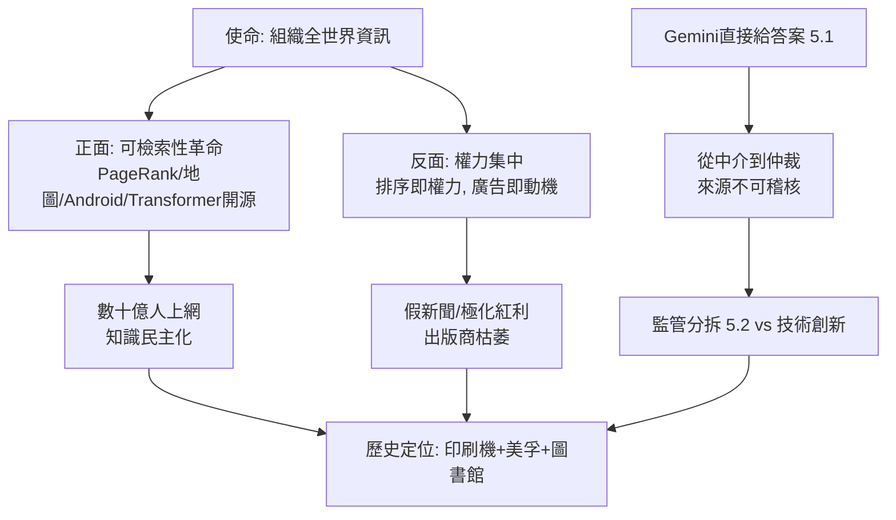

# 5.3 對世界資訊秩序的影響

Google 的墓誌銘或頌歌，都可以寫同一句話：**它讓全人類的知識第一次變得可即時檢索，也讓「誰決定你看到什麼」第一次掌握在單一私人演算法手裡。** 這是同一枚硬幣的兩面。

正面遺產無需贅言。PageRank（1.3）讓劣質內容農場沉底，優質知識浮現；Google Scholar（2004）改變了學術引用生態；地圖與翻譯（3.1）讓偏鄉診所與小語種文學第一次進入全球資訊網；Android（3.2）把智慧型手機價格打到 100 美元以下，數十億人第一次上網就是透過 Google；Transformer 的開源（4.2）則把 AI 能力還給全世界。從識字率到創業率，無數發展經濟學指標背後都有一個免費的搜尋框。公司使命「組織全世界的資訊，使人人皆可觸及並從中受益」（to organize the world's information），在很大程度上真的做到了前半句。

但硬幣的另一面是資訊權力的集中。排序即權力：第一頁與第二頁的點擊率相差數十倍，演算法的微調就是選舉、市場與輿論的微調；廣告即動機：以注意力變現的公司，必然偏好讓人停留而非讓人離開的內容，假新聞與極化因此獲得結構性紅利；問答即終點：Gemini 與 AI Overviews（5.1）更進一步——連「選擇點哪個連結」的自由都被收回，機器直接告訴你答案，而答案的來源不再可稽核。從「幫你找到資訊」到「替你決定答案」，Google 走完了資訊中介的最後一哩，也走到了自由主義資訊觀的邊界。

歷史會如何定位 Google？它像百年前的美孚石油與 AT&T：以技術與規模重塑世界，再以壟斷與權力被世界審判；它也像印刷機與圖書館的合體——既是工具，又是秩序。佩奇與布林 1998 年在車庫裡想回答的問題是「如何找到最好的網頁」；2026 年的世界要回答的問題是「誰有權定義最好」。前一個問題有數學解（PageRank），後一個沒有。

## 因果鏈

- **前因**：這是全書因果鏈的總匯——1.1 的價值觀（資訊應自由）催生 1.3 的數學（連結即投票），數學贏得 2.1 的用戶，用戶養出 2.2 的廣告，廣告供養 3.1–3.3 的帝國，帝國孵化 4.2 的 AI，AI 在 4.3 的競爭中被迫早產為 5.1 的答案引擎，而答案引擎最終在 5.2 的法庭上受審。每一波的解藥都是下一波的毒藥。
- **後果**：Google 的故事尚未結束，但它留給後來者的命題已經清晰——技術（PageRank、Transformer）→ 產品（搜尋、Gemini）→ 商業（AdWords、訂閱）→ 組織（Alphabet）→ 下一波技術的飛輪仍在旋轉，只是下一棒或許不再屬於 Google。傳記的終點不是結論，而是一個開放問題：當機器能替我們組織一切資訊，人類還需要親自尋找嗎？
