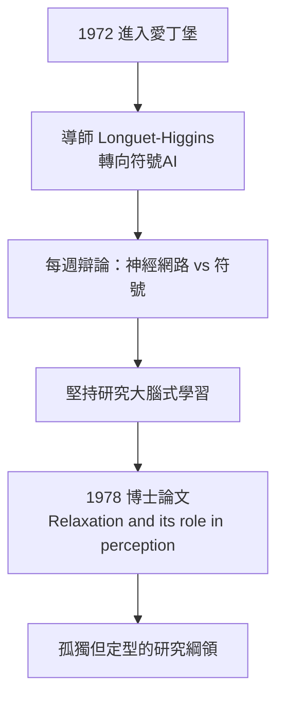

# 1.2 愛丁堡博士與符號 AI 時代的孤獨（1972–1978）

1970 年從劍橋畢業後，辛頓嘗試過進入倫敦的學術圈，甚至考慮過木匠生涯。1972 年，他找到一個勉強合適的落腳點：蘇格蘭的**愛丁堡大學**——當時英國唯一有一個正式人工智慧學系的大學。他註冊成為博士生，從此踏上一條持續了半個世紀的路。

## 愛丁堡 AI 實驗室

愛丁堡大學人工智慧系的淵源可追溯到 1960 年代：

- 實驗室由唐納德·米基（Donald Michie）創建——米基是二戰布萊切利園（Bletchley Park）的密碼分析師，曾與圖靈共事破譯恩尼格瑪（→ 詳見《圖靈傳記》第 3 章）；
- 米基的研究方向是機器學習與智能行為的機制，比 MIT—史丹佛一系的符號 AI 更貼近生物學；
- 但到辛頓入學時，實驗室的氛圍已轉向典型的符號 AI：專家系統、知識表示、邏輯規劃；
- 辛頓的指導教授是克里斯多福·朗格特—希金斯（Christopher Longuet-Higgins），一位化學家出身的認知科學家。

## 導師的劇變

朗格特—希金斯是辛頓學術命運的第一個關鍵人物，而這段關係充滿戲劇性：

- 朗格特—希金斯最初也對神經網路有興趣，辛頓正是衝著他來的；
- 但就在辛頓入學前後，朗格特—希金斯**改變了立場，轉向符號 AI**；
- 辛頓回憶：每週見導師一次，導師會問「你為什麼還在搞這個？」——師生的信仰恰好對調；
- 辛頓被迫學會一件事：**在沒有人相信你的環境裡自己相信自己的直覺**。

## 博士論文：鬆弛與知覺

1978 年辛頓提交博士論文《Relaxation and its Role in Perception》。核心思想在日後三十年反覆變奏：

- **知覺是一種約束滿足**：看見一個立方體，就是讓大腦中的假設單元在互相約束下「鬆弛」到一致的狀態；
- 這個框架與數值計算中的模擬退火、能量最小化同構——日後 Boltzmann 機的種子（見 2.1）；
- 論文中的模型沒有大規模實驗支撐，因為當時沒有算力、沒有資料、也沒有幾個同行看得懂；
- 論文答辯過程一波三折——據辛頓回憶，第一次答辯不順利，他事後表示「我和考試委員對什麼是好的科學有不同意見」。

## 凜冬中的孤獨

1970 年代的連結主義研究是怎樣的處境：

- 1969 年《感知器》一書宣告：單層感知器連 XOR 都學不會，多層網路「無望」；
- 美國 AI 經費幾乎全部流向符號路線——麥卡錫等人在 LISP、定理證明、知識表示上建立正統（→ 詳見《麥卡錫傳記》第 4 章）；
- 辛頓選擇神經網路，等於選擇了**失業風險與學術邊緣化**；
- 他自嘲那段歲月：「整個領域大概只有幾十個人，我們互相知道對方在做什麼。」

### 同時代的地下網絡

凜冬中的連結主義者形成一張小小的地下網絡：

- 加州大學聖地牙哥分校（UCSD）的魯梅爾哈特（David Rumelhart）與麥克萊蘭（James McClelland）研究「互動激活化模型」；
- 福島邦彥在日本提出 Neocognitron（1980），已有卷積結構的雛形；
- 芬蘭的科霍寧（Teuvo Kohonen）發展自組織映射；
- 而物理學界，霍普菲爾德（John Hopfield）1982 年將統計力學引入神經網路——這是打破僵局的第一槍（見 2.1）。

辛頓與這張網絡的交點，出現在他博士快畢業時：UCSD 的一群認知科學家開始注意到英國這個固執的年輕人。

## 事件關聯與前因後果

| 年份 | 事件 | 後續影響 |
|------|------|----------|
| 1972 | 入學愛丁堡 AI 系 | 與符號 AI 正面共處、正面對抗 |
| 1973 | 導師轉向符號路線 | 學會獨立堅持異端研究方向 |
| 1975 前後 | 發展「約束鬆弛」框架 | Boltzmann 機與能量模型的思想基礎 |
| 1978 | 博士論文完成 | 進入認知科學與神經網路小圈子 |

**因果**：如果說香農的碩士論文是「把布爾代數工程化」（→ 詳見《香農傳記》第 2 章），辛頓的博士論文則是**反方向的一步：把布爾邏輯從智慧的寶座上請下來**。愛丁堡實驗室由米基（圖靈的戰友）創立、卻由符號 AI 主導，這個背景使辛頓的博士訓練異常吊詭：他在符號 AI 的巢裡孵出了反符號的蛋。導師的倒戈反而強化了他的信念——他後來說，那幾年最重要的一課是「直覺比流行的論證更可靠，但直覺需要幾十年才能被證明是對的」。

### 圖靈的陰影

值得一記的是路線之爭的哲學根源：圖靈 1950 年在《計算機器與智能》中故意迴避「機器是否思考」的定義戰，用模仿遊戲（圖靈測試）取而代之（→ 詳見《圖靈傳記》第 4 章）。符號 AI 讀出的是「機器可以推理」；辛頓讀出的是**「機器可以像孩子一樣學習」**——圖靈在文末明確主張模擬兒童心智的學習機器路線。辛頓研究的正是圖靈那條被達特茅斯正統冷落的路線。

## 小結

- 愛丁堡時期（1972–1978）把辛頓從「有直覺的異端」變成「有理論框架的研究者」：知覺＝約束滿足＝能量鬆弛；
- 導師朗格特—希金斯的轉向是壓力也是淬鍊：他的研究綱領在孤立中定型；
- 當時的學術環境決定了他此後的方向選擇——凡是符號 AI 的正統重鎮，皆非久居之地；
- 博士畢業前後，UCSD 認知科學圈的信號出現：那裡有一群人在做「互動激活化模型」；
- 1978 年之後，下一步是橫渡大西洋，與魯梅爾哈特相遇——PDP 時代的前奏（見 1.3）。
