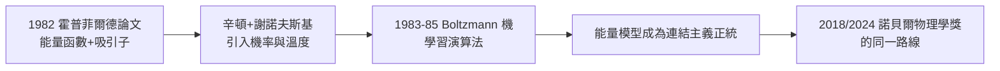

# 2.1 霍普菲爾德網路與 Boltzmann 機（1982–1985）

1982 年，普林斯頓的物理學家約翰·霍普菲爾德（John Hopfield）在《美國國家科學院院刊》發表〈神經網路與具有集體計算能力的物理系統〉。這篇論文像一顆投入結冰湖面的石頭：物理學的正統性突然降臨神經網路這個被 AI 界遺棄的領域。辛頓敏銳地意識到——機會來了。

## 霍普菲爾德的洞見

霍普菲爾德的模型有三個致命的吸引力：

- **能量函數**：每個網路狀態對應一個能量 $E = -\frac{1}{2}\sum_{i,j} w_{ij}s_i s_j$，網路動力學總是往能量降低的方向走；
- **內容定址記憶**：記憶以「吸引子」（attractor）的形式儲存在權重中——給出殘缺的輸入，網路自動滑入最近的完整記憶，如同大腦由香味喚起整段回憶；
- **物理學的正統語言**：自旋玻璃、Ising 模型、統計力學——物理學家一看就懂，這為神經網路爭到了主流科學的入場券。

## 謝諾夫斯基與 Boltzmann 機

1982 年辛頓轉到匹茲堡卡內基美隆大學（CMU）任教（見 2.3），在這裡遇到物理學博士後**泰瑞·謝諾夫斯基（Terrence Sejnowski）**。兩人在霍普菲爾德的能量框架上補上最關鍵的一塊：

- 霍普菲爾德網路是確定性的：永遠向低能量滑落，問題是只能學（用 Hebb 規則）不能學複雜結構，且容易陷入局部極小；
- 辛頓與謝諾夫斯基加入**溫度**：單元以機率 $P(s_i=1)=\frac{1}{1+e^{-E_i/T}}$ 更新狀態——高溫時隨機遊走，低溫時冷卻定型；
- 這就是**模擬退火**用於神經網路：先用熱雜訊跳出局部極小，再慢慢降溫收斂；
- 1985 年論文《A Learning Algorithm for Boltzmann Machines》給出學習規則：比較「資料夾持下」與「自由運行下」的統計量，調整權重使兩者一致——$\Delta w_{ij} \propto \langle s_i s_j\rangle_{\text{data}} - \langle s_i s_j\rangle_{\text{model}}$。

### 學習的生物合理性

Boltzmann 機有一個連結主義者鍾愛的性質：**學習是完全局部的**。每個神經元只需要知道相鄰單元的活動（相關聯），不需要全域的誤差訊號。辛頓認為這比反向傳播更「像大腦」——儘管命運捉弄人：最後改變世界的恰恰是不太像大腦的反向傳播（見 2.2）。

## 意義：能量模型的正統化

1982–1985 這三年的連鎖反應：

- 霍普菲爾德 1982 → 辛頓—謝諾夫斯基 1985 → 連結主義獲得物理學背書與第一個普適的無監督學習演算法；
- 能量模型的思想譜系延續至今：受限 Boltzmann 機（RBM）是 2006 年深度信念網路的核心（見 3.2）；當代的擴散模型（diffusion models）本質上也是能量式的去噪學習；
- 辛頓終身堅持的主題在此定型：**學習＝讓模型內部的統計與外部世界的統計一致**——這是 1950 年代香農資訊理論「匹配信源統計」思想的迴響（→ 詳見《香農傳記》第 3 章）；
- 四十年後的 2024 年，諾貝爾物理學獎同時頒給霍普菲爾德與辛頓，正是頒給這條「統計物理—神經網路」的路線（見 5.3）。

## 事件關聯與前因後果

| 年份 | 事件 | 後續影響 |
|------|------|----------|
| 1982 | 霍普菲爾德網路論文 | 能量函數與吸引子記憶；物理學界回流 |
| 1982 | 辛頓轉任 CMU | 與謝諾夫斯基合作（見 2.3） |
| 1983 | 退火想法成形 | 模擬退火引入神經網路 |
| 1985 | Boltzmann 機學習演算法 | 第一個通用無監督學習演算法 |
| 1986 | 與反向傳播同時期發表 | 連結主義復興的雙引擎（見 2.2） |

**因果**：沒有霍普菲爾德 1982 年的論文，就沒有 Boltzmann 機——這是辛頓一再公開承認的因果鏈。霍普菲爾德本人並非 AI 學界中人，他是被凝聚態物理「借調」過來的：他關心的是自旋玻璃中的集體行為，神經網路只是他眼中的另一個物理系統。而辛頓的功勞在於看清這個物理玩具**可以用來學習**——把「記憶的儲存」升級為「結構的歸納」。這也再次印證了本傳記的反覆主題：突破往往發生在學科邊界上，正如香農在電機與數學之間、圖靈在邏輯與工程之間（→ 詳見《圖靈傳記》第 2 章）。

### 當時的反應

有趣的是兩個學界的不同反應：AI 界（符號正統）對 Boltzmann 機普遍冷淡——太慢、太低階、解決的問題「不夠智能」；物理學界與認知科學界則相當熱情。CMU 同事中，紐厄爾與西蒙的學生們大多持懷疑態度——辛頓在自己的新東家再次處於少數（見 2.3）。

## 小結

- 霍普菲爾德 1982 年提供了能量函數與吸引子記憶，辛頓—謝諾夫斯基 1985 年提供溫度、退火與學習規則；
- Boltzmann 機＝霍普菲爾德網路＋機率＋學習；核心公式是資料統計與模型統計之差；
- 能量模型路線成為辛頓的終身招牌，直通 2006 年 DBN 與 2024 年諾貝爾獎；
- 局部學習規則的生物合理性信念，使辛頓一度認為 Boltzmann 機優於反向傳播——這場內部之辯見下章；
- 同一時期，辛頓在 CMU 的教職與「分散式表徵之辯」也在展開（見 2.2、2.3）。
