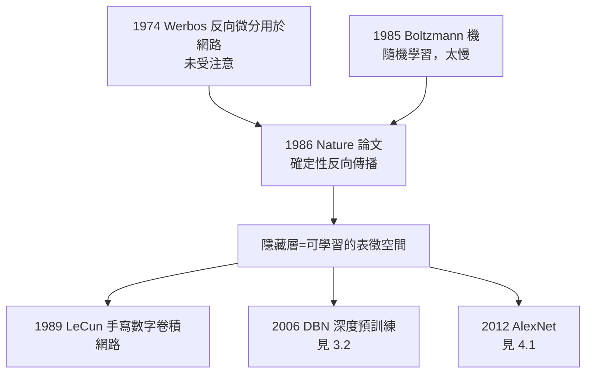

# 2.2 反向傳播論文（1986）

1986 年 10 月 9 日出版的《自然》（Nature）第 323 卷，刊出一篇僅五頁的論文：魯梅爾哈特、辛頓與威廉斯（Ronald Williams）合著的〈透過反向傳播誤差學習表徵〉（Learning representations by back-propagating errors）。這篇論文後來被引用超過十萬次，是神經網路歷史的分水嶺，也是深度學習時代的技術起點。

## 問題的由來

多層網路的學習難題（見 1.3）在 1982–1985 年間被反覆啃咬：

- 核心困難是 credit assignment：誤差出現在輸出層，責任卻分散在所有隱藏層權重上；
- 1985 年辛頓與謝諾夫斯基剛完成 Boltzmann 機的學習規則（見 2.1），但那是隨機的、極慢的；
- 魯梅爾哈特提議回到確定性路線：**如果每個單元是平滑可微的，那麼誤差對每個權重的偏導數就可以用鏈式法則逐層往回算**；
- 三人合成的演算法：前向計算輸出、反向逐層分配誤差 $w \leftarrow w - \eta \frac{\partial E}{\partial w}$。

### 嚴格說，不是發明

必須誠實記錄優先權的複雜性——反向傳播是一個被「重新發現」多次的演算法：

- 1970 年芬蘭的林納馬（Seppo Linnainmaa）已在數值分析中給出反向模式自動微分；
- 1974 年哈佛的韋博斯（Paul Werbos）博士論文已把反向微分用於多層網路；
- 1986 年論文的真正貢獻不是首創，而是**以清晰的形式、決定性的實驗與正確的詮釋，讓整個學界第一次接受了它**——魯梅爾哈特的數學表述、辛頓的表徵視角、威廉斯的推導與程式，缺一不可；
- 辛頓後來自嘲：「我們是把它發表在對的地方、用對的說法的人。」

## 論文的殺手實驗

論文中的實驗在今日看來平凡，在當時卻是震撼彈：

- **家族樹（family tree）**：一個小網路經訓練後，隱藏層自動學出「世代」「家族分支」的內部特徵——網路**自己發明了分散式表徵**來解決任務；
- **XOR 與對稱性問題**：明斯基—帕普特宣告無解的問題，三層網路輕鬆學會；
- **字串預測與語音**：顯示方法的普適性；
- 論文標題的最後兩個字「representations」是辛頓堅持的重點：學到的不只是函數，是**表徵**。

## 與 Boltzmann 機的內部之辯

耐人尋味的是，辛頓本人的態度很矛盾：

- 他長期認為反向傳播「生物上不合理」——大腦無法把誤差訊號逐層反向傳遞；
- 魯梅爾哈特的務實主義勝出：先解決工程問題，生物合理性以後再說；
- 結果是 1986 年後反向傳播成為主流，Boltzmann 機退居特別用途；
- 四十年後辛頓仍在研究「大腦如何實作反向傳播」，並主張也許大腦用的是某種近似——他稱之為他最想解開的謎題之一；
- 這場內部之辯也預示了他與整個主流的張力：他從來不是「神經網路工程師」，而是「想理解大腦、順便發明好工程的人」。

## 標題裡的哲學

論文悄悄回答了一個哲學問題：**智慧需要先天符號結構嗎？**

- 喬姆斯基式語言學與符號 AI（→ 詳見《麥卡錫傳記》第 4 章）主張：高階認知必須有內建的符號規則；
- 家族樹實驗給出反例：**規則可以從資料中以分散式方式湧現**，不需要任何符號引擎；
- 這是對圖靈 1950 年「兒童機器」主張（→ 詳見《圖靈傳記》第 4 章）的第一個工程實證：圖靈設想的學習機，在 1986 年有了可運行的雛形；
- 同一時代，羅素與懷海德《數學原理》式的「一切知識皆形式推演」傳統（→ 詳見《羅素傳記》第 5 章），在連結主義眼中成為需要被超越的對象。

## 事件關聯與前因後果

| 年份 | 事件 | 後續影響 |
|------|------|----------|
| 1970 | 林納馬：反向模式自動微分 | 數學基礎早已存在 |
| 1974 | 韋博斯博士論文 | 首次應用於神經網路，未被注意 |
| 1985 | Boltzmann 機學習規則 | 無監督路線先行（見 2.1） |
| 1986 | Nature 反向傳播論文 | 多層學習的通用解；連結主義復興 |
| 1989–1998 | LeCun 卷積網路應用 | 深度學習的第一批工程成果 |
| 2006/2012 | DBN / AlexNet | 深度學習時代開閘（見 3.2、4.1） |

**因果**：1986 年論文的成功依賴一條完整的前因鏈——愛丁堡的約束鬆弛（1.2）、UCSD 的分散式表徵（1.3）、霍普菲爾德的能量函數（2.1），再加上魯梅爾哈特「敢用微積分」的決斷。而它的後果鏈更長：沒有反向傳播，就沒有 1998 年 LeCun 的 LeNet、沒有 2012 年的 AlexNet、沒有 2020 年代的一切大模型。它是整條深度學習血脈的共同祖先。

### PDP 手冊

論文發表的同年，魯梅爾哈特與麥克萊蘭主編的《平行分散式處理》（Parallel Distributed Processing，1986）兩卷本問世，辛頓參與其中。PDP 手冊把連結主義整理成有架構、有演算法、有哲學的完整綱領——它與 Nature 論文互為表裡：論文是武器，手冊是憲法。連結主義從此不是異端邪說，而是一門學科。

## 小結

- 1986 年論文的三位作者各司其職：魯梅爾哈特的數學、辛頓的表徵哲學、威廉斯的推導驗證；
- 核心貢獻是「隱藏層可以學到分散式表徵」的實證——家族樹實驗是整個深度學習的prototype；
- 反向傳播與 Boltzmann 機構成 1986 年連結主義復興的雙引擎：一個監督、一個無監督；
- 辛頓對其生物合理性的存疑，貫穿他此後四十年的研究日程；
- 但在 CMU 的走廊裡，另一場辯論正在等他：紐厄爾—西蒙的符號正統如何對待這個新來的異端（見 2.3）。
