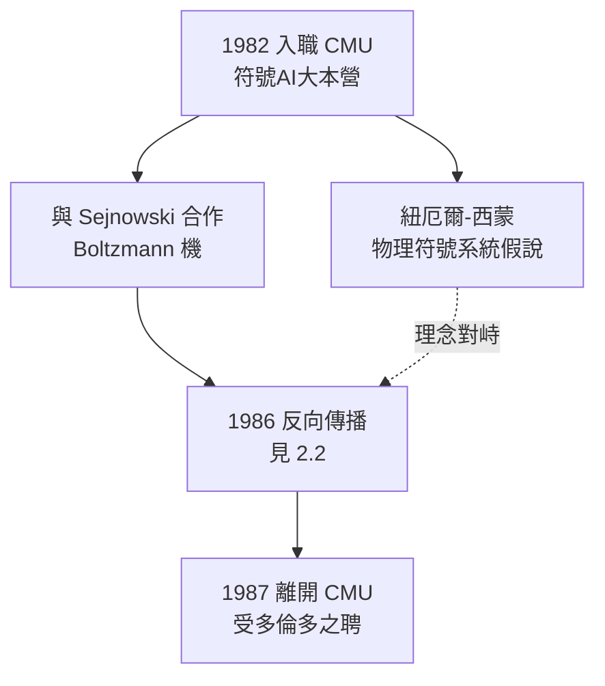

# 2.3 CMU 教授與分散式表徵之辯（1982–1987）

1982 年，在 UCSD 博士後合約將近之際，辛頓獲得卡內基美隆大學（CMU）的助理教授職位。這個選擇意味深長：CMU 是符號 AI 最強的正統大本營——紐厄爾（Allen Newell）與西蒙（Herbert Simon）的物理符號系統假說在此稱帝（→ 詳見《麥卡錫傳記》第 4 章中同時代的符號陣營）。辛頓選擇深入敵營，一待五年。

## 為什麼去 CMU

辛頓的理由事後說得很直白：

- 當時美國給神經網路研究者的教職機會極少，CMU 是少數願意收留他的；
- 他相信「到敵人最強的地方去辯論」：如果分散式表徵真的更好，就該在符號主義的心臟證明它；
- CMU 的電腦科學系足夠寬容——紐厄爾本人對辛頓相當友善，儘管理念不同；
- 而且他需要與謝諾夫斯基合作（見 2.1），CMU 兩人得以同處。

## 物理符號系統 vs 連結主義

1980 年前後兩大陣營的正面對決，是認知科學史上最著名的路線之辯：

| | 符號主義（CMU 正統） | 連結主義（辛頓一派） |
|---|---|---|
| 假說 | 物理符號系統＝智慧 | 智慧來自簡單單元的集體動力學 |
| 表徵 | 局部符號、明確結構 | 分散式向量、湧現特徵 |
| 學習 | 知識靠程式設計與規則 | 權重靠資料調整 |
| 哲學近親 | 弗雷格—羅素的邏輯傳統（→《弗雷格傳記》《羅素傳記》） | 經驗論、赫布學習 |
| 預測 | 專家系統統治世界 | 大資料＋梯度下降統治世界 |

- 紐厄爾與西蒙 1976 年的圖靈獎演說宣告：物理符號系統假說是「智慧的必要且充分條件」；
- 辛頓的回應藏在 1986 年家族樹實驗裡（見 2.2）：符號規則可以從向量活動中湧現，符號是結果而非前提；
- 他多年後總結這場辯論：「他們認為概念是符號、符號間有邏輯關係；我們認為概念是特徵的集合、特徵間有相似性結構。」

## 凜冬將盡的歲月

CMU 五年是連結主義由谷底回升的五年：

- 1982 霍普菲爾德論文、1983–85 Boltzmann 機、1986 反向傳播＋PDP 手冊——每一步都有 CMU 的參與或迴響；
- 1985 年起，「認知神經科學」開始成形，連結主義與心理學、神經科學的結盟日深；
- CMU 內部，紐厄爾 1986 年後期開始重新思考「符號與次符號」的統一——直到 1992 年去世前，他都保持著對連結模型的開放態度；
- 但軍備競賽的天平傾向資料與算力：CMU 的符號系統（SOAR 等）越來越精巧，卻始終無法從原始輸入中自己學到結構。

### 一個著名的細節

辛頓常提起在 CMU 的經歷：有一次他向系裡同事展示神經網路學習的結果，得到的反應是「這說明了什麼？你不知道它在做什麼。」——**網路學到的分散式表徵無法被人類閱讀**，這在符號主義者看來是缺陷，在辛頓看來恰恰是大腦的特性：你也不知道自己小腦裡的十億個突觸在「做什麼」。可解釋性之辯至今仍是 AI 的核心爭議，而它的原型就出現在 1980 年代的 CMU 走廊。

## 離開匹茲堡

1987 年，加拿大出手了：

- 多倫多大學提供正教授職位，且允許他自由研究方向；
- 加拿大政府與大學系統對這種「冷門但原創」的研究容忍度更高；
- 同一時期，LeCun 在貝爾實驗室、Bengio 在 MIT 與貝爾實驗室之間，年輕一代的連結主義者開始集結；
- 辛頓離開 CMU 的另一個動機是個人層面的：1985 年前後他的第二段婚姻結束，換一個大陸也意味著重新開始。

## 事件關聯與前因後果

| 年份 | 事件 | 後續影響 |
|------|------|----------|
| 1982 | 任教 CMU | 深入符號主義心臟地帶 |
| 1982–85 | 與謝諾夫斯基發展 Boltzmann 機 | 能量模型正統化（見 2.1） |
| 1986 | 反向傳播論文＋PDP 手冊 | 連結主義復興（見 2.2） |
| 1986 | 與符號正統的當面辯論常態化 | 「符號是湧現的」論點定型 |
| 1987 | 轉任多倫多大學 | 長達四十年的多倫多時代（見 3.1） |

**因果**：CMU 時期看似是辛頓的邊緣歲月，實則是他思想的煉獄期。在符號主義最強的地方被迫回答最尖銳的攻擊——「你的模型解釋不了邏輯推理」「你的表徵不可讀」——逼出了他日後一以貫之的論證策略：**不否認符號行為的存在，而是主張符號由向量活動湧現**。這正是後來大語言模型的哲學預言：GPT 沒有知識庫，卻能輸出合邏輯的句子。1980 年代在 CMU 走廊裡輸掉辯論的辛頓，用三十年的時間在工業規模上贏回整場戰爭。

## 小結

- CMU 五年（1982–1987）是學術上的兩線作戰：與謝諾夫斯基建設能量模型，與紐厄爾—西蒙正統正面交鋒；
- 物理符號系統假說 vs 分散式表徵，是認知科學的世紀之辯，辛頓站在挑戰方；
- 辯論的產物是「符號湧現論」：概念＝特徵向量，規則＝幾何結構——深度學習的哲學底稿；
- 1986 年的雙成果（反向傳播、PDP 手冊）使連結主義完成了從異端到學科的轉身；
- 1987 年，加拿大提供更好的土壤，多倫多時代開始（見 3.1）。
