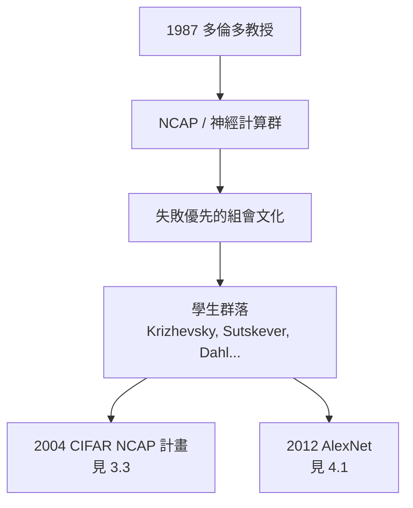

# 3.1 多倫多大學與 CNC3（1987–2000s）

1987 年，辛頓舉家遷往加拿大，出任多倫多大學電腦科學系教授。此後三十餘年，多倫多就是辛頓的代名詞。這座加拿大的學術重鎮，成了連結主義流亡者的最後據點，也是深度學習復興的溫床。

## 加拿大的學術生態

辛頓為什麼選多倫多，為什麼多倫多能等三十年：

- 加拿大學界的評價體系對「短期無產出」更寬容：辛頓近二十年沒有轟動成果，教職穩固；
- 電腦科學系給了他完全的自由——不要求他改行做主流方向；
- 他聚集了一批同樣執拗的年輕人：在別處找不到位置的連結主義者，多倫多一律歡迎；
- 加拿大先進研究院（CIFAR）後來成為關鍵推手（見 3.3）。

## CNC3：從心理學到電腦科學的橋

辛頓在多倫多的早期建制成果之一，是參與創立並領導系內的「神經計算」課程與研究群：

- 1990 年代，他與心理學、電機系的同事共同建立**神經計算與適應感知**（Neural Computation and Adaptive Perception, NCAP）計畫；
- 這個計畫後來演變為系裡的機器學習群（machine learning group），成員俗稱 CNC3 一線的研究共同體——一群橫跨神經科學、心理學與電腦科學的人；
- 辛頓的組織方式極具個人色彩：每週例會上，所有人輪流報告，他不許任何人只講成功結果，「講你不懂的東西」是他的座右銘；
- 這種「失敗優先」的文化，直接塑造了多倫多一系的風格：Ilya Sutskever、Alex Krizhevsky、George Dahl 等人都在這種文化中成長（見 4.1）。

## 九十年代的漫長隧道

1987–2000 年代初，是反向傳播之後的漫長徘徊期：

- 神經網路的應用（LeCun 的手寫數字識別等）有局部的成功，但深層網路**訓練不動**：梯度逐層消失，$|\sigma'| \le \frac{1}{4}$ 使深層的梯度以指數速度衰減；
- 學界的主流轉向核方法（SVM）與統計學習理論——數學優雅、理論保證完備，而神經網路被視為「需要煉丹的黑箱」；
- 辛頓在這段時間發表了一系列在他看來更本質的工作：專家乘積系統（products of experts, 1999–2002）、對比散度（contrastive divergence, 2002）——後者讓 Boltzmann 機的訓練第一次變得可行，是 2006 年 DBN 的直接技術前提（見 3.2）；
- 他也在語音與視覺上持續小規模嘗試，但算力與資料都是瓶頸。

### 對比散度：為深層復興備糧

2002 年的對比散度值得單獨一筆：Boltzmann 機的學習規則需要從模型中採樣（需要長時間的馬可夫鏈），辛頓發現**只需要跑幾步的粗採樣就足以得到可用的梯度**——這個「不完美但夠用」的近似，把 RBM 訓練速度提升幾個數量級。沒有對比散度，就沒有 2006 年的逐層預訓練。凜冬裡的每一篇論文，都是春天的伏筆。

## 學生們

辛頓作為導師的紀錄在電腦科學史上極為罕見：

- 他指導或共同指導的學生中，走出了一整代深度學習的核心人物：Ilya Sutskever（後為 OpenAI 首席科學家）、Alex Krizhevsky、George Dahl、Ruslan Salakhutdinov、Radford Neal 等；
- 他的教育哲學：「我從來不告訴學生他們錯了。我讓他們走進死胡同，直到自己發現。發現自己錯了的人才學得會。」；
- 他招募學生的標準同樣反主流：不看成績，看「對問題的直覺與固執」；
- 這個學生網絡在 2012 年之後成為整個 AI 產業的地質斷層帶（見 4.2）。

## 事件關聯與前因後果

| 年份 | 事件 | 後續影響 |
|------|------|----------|
| 1987 | 就任多倫多大學教授 | 連結主義流亡者的據點建立 |
| 1990s | NCAP / 神經計算群 | 跨學科共同體與學生網絡 |
| 1998 | 深度網路梯度消失問題確認 | 深度學習的技術瓶頸定義 |
| 2002 | 對比散度演算法 | RBM 可訓練，DBN 的前提 |
| 2004 | CIFAR 贊助 NCAP 計畫 | 學術資源網成形（見 3.3） |

**因果**：多倫多時代的第一個十五年證明了一個組織學命題——**在主流之外，一個有耐心的小共同體可以活過整個冬天**。辛頓的方法不是在主流期刊上爭辯，而是經營一小塊土壤：課程、組會、學生、跨學科計畫。這與 1940 年代貝爾實驗室容納香農（→ 詳見《香農傳記》第 3 章）、劍橋容納圖靈的機制異曲同工：突破需要的是**允許無用研究的制度縫隙**。加拿大的制度縫隙比美國寬，這就是深度學習誕生在多倫多而非矽谷的第一原因。

## 小結

- 多倫多（1987–）是辛頓的根據地：制度的寬容使他能把異端研究做足二十年；
- 神經計算共同體與「失敗優先」組會文化，培養出深度學習的第一代主帥；
- 1990 年代的隧道期以對比散度（2002）收尾——Boltzmann 機終於可訓練；
- 梯度消失問題、算力瓶頸、資料匱乏三大障礙已經被清晰指認，只等技術解法；
- 2006 年，這三重障礙在一篇論文裡同時被撼動——深度學習的復興之年到了（見 3.2）。
