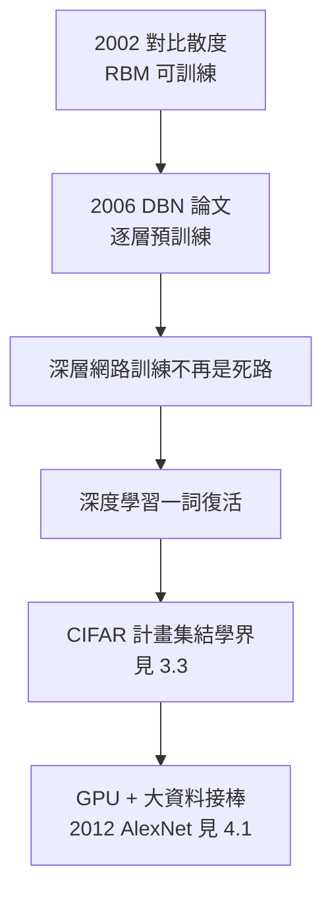

# 3.2 深度信念網路（2006）

2006 年，辛頓與學生薩拉赫特迪諾夫（Ruslan Salakhutdinov）及奧辛德羅（Simon Osindero）在《神經計算》（Neural Computation）發表〈深度信念網路的快速學習演算法〉（A Fast Learning Algorithm for Deep Belief Nets）。論文的宣稱石破天驚：**深層神經網路可以有效地訓練了**。沉寂二十年的「深度學習」一詞，從這一年開始復活。

## 三重障礙與逐層解法

2006 年之前，深層網路訓練失敗的原因已經被清楚指認：

- **梯度消失**：Sigmoid 的導數上界為 $\frac{1}{4}$，反向傳播每過一層梯度至少縮四倍，十層之後深層權重幾乎得不到訊號；
- **局部極小**：隨機初始化的深層網路收斂到糟糕的解；
- **資料與算力不足**：沒有網際網路規模的資料，也沒有 GPU。

辛頓的解法是一個「分而治之」的曲線救國：

- 逐層堆疊受限 Boltzmann 機（RBM）：先訓練第一層，把輸入轉成特徵；**凍結**第一層，用其輸出訓練第二層；依此類推；
- 這叫**逐層無監督預訓練**（greedy layer-wise pretraining）：每一層學到的不是任務答案，而是**輸入的好表徵**；
- 預訓練完成後，再做一次有監督的微調（fine-tuning）；
- 數學上，每層 RBM 用對比散度（2002，見 3.1）訓練，保證每步都可算、可收斂；
- 結果：預訓練提供了一個「好的初始點」，使後續反向傳播能收斂到好得多的解——MNIST 手寫數字、語音資料上的錯誤率同時大幅下降。

## 「信念網路」的深意

論文題目中的「信念網路」（belief nets）不是隨手措辭：

- 每層 RBM 定義一個機率生成模型：$P(v,h) \propto e^{-E(v,h)}$，網路在**學資料的機率分布**，而非僅擬合標籤；
- 這是辛頓的終身立場的展開（見 2.1）：**智慧＝對世界統計結構的內部模型**；
- 生成式視角還允許「由上而下的想像」：從隱藏層往下採樣可以「畫出」網路認為的手寫數字——表徵不只是壓縮，是可逆的模型；
- 諷刺的是，深度學習後來的主流恰恰拋棄了生成式預訓練：2010 年代中期，ReLU、BatchNorm、殘差連接等技術讓「直接監督訓練深層網路」成為可能，預訓練一度失寵；
- 但歷史轉了個圈：2018 年之後的大語言模型（BERT、GPT）以「預訓練＋微調」為標配——只是預訓練從 RBM 換成了自我監督（self-supervised）。辛頓 2006 年的綱領——先學表徵、後學任務——以另一種形式統治了 AI。

## 復興的訊號

2006 年論文發出後，業界與學界的反應鏈：

- 微軟研究院、IBM、Google 的語音團隊率先注意到：George Dahl 等人多倫多與微軟合作的語音識別實驗，錯誤率相對下降三成，遠超當時任何改進；
- 2007 年起，辛頓受邀四處演講（見 3.3），論文引用曲線陡升；
- 學界重新開始錄用神經網路方向的博士——凜冬結束的確切標誌；
- 但必須誠實記錄：2006 年的突破本身沒有直接變成產品，**它的作用是證明「深度」可行，把整個學界的注意力拉回神經網路**。真正的爆破還要等 GPU 與大資料到位（見 3.3、4.1）。

## 事件關聯與前因後果

| 年份 | 事件 | 後續影響 |
|------|------|----------|
| 2002 | 對比散度演算法 | RBM 訓練可行，DBN 的技術前提 |
| 2006 | DBN 論文（逐層預訓練） | 深度學習復興的發令槍 |
| 2006–09 | 語音識別突破（多倫多—微軟等） | 產業界首次下注深度學習 |
| 2008–10 | 學界回歸神經網路 | 新一代研究者入場 |
| 2012 | AlexNet | 預訓練雖被棄用，深度路線全面獲勝（見 4.1） |
| 2018+ | 大模型的預訓練＋微調範式 | 2006 綱領以自我監督形式復活 |

**因果**：DBN 論文的前因鏈橫跨二十四年——霍普菲爾德的能量函數（1982，見 2.1）→ Boltzmann 機（1985）→ 對比散度（2002）→ 逐層堆疊（2006）。這是一條由一個人（與少數同伴）在整個學界不看好的情況下堅持出來的因果鏈。它的後果鏈則通向整個 AI 產業：沒有 2006 年的「深度可行」證明，就沒有 2012 年的 ImageNet 賭注，也就沒有今天的深度學習霸權。歷史學者後來把 2006 年定為「深度學習元年」——而元年的主角，當時已經五十九歲。

### 與其他路線的對照

2006 年前後的主流學界還有兩個競爭範式：核方法（SVM，理論完備但特徵手工設計）與圖模型（貝葉斯網路，機率正統但結構需人定）。深度學習的勝出密碼，正是辛頓三十年來的堅持：**特徵應該被學出來，而不是被設計出來**。這句話反過來就是對符號 AI（→ 詳見《麥卡錫傳記》第 4 章）最徹底的否決：知識不應被寫進去，而應被長出來。

## 小結

- DBN 論文（2006）用逐層無監督預訓練＋微調，首次證明深層網路可有效訓練；
- 技術鏈：能量函數（1982）→ Boltzmann 機（1985）→ 對比散度（2002）→ DBN（2006）；
- 「先學表徵、後學任務」的綱領，在 2018 年後以自我監督預訓練的形式統治大模型時代；
- 2006 年的直接產出是語音識別突破與學界回歸，間接產出是 2012 年的全面爆破；
- 深度可行已被證明，但革命還缺兩樣東西：算力與資料——下一章是辛頓為籌措它們而進行的「路演」（見 3.3）。
