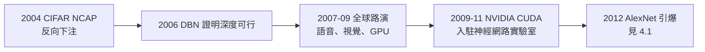

# 3.3 湯普森路演與 GPU 時代（2007–2012）

2006 年 DBN 論文證明了深度的可行性（見 3.2），但深度學習要在工程上爆破，還缺算力與資料的聯姻。2007–2012 這五年，辛頓做了一件他此前從未做過的事：走出實驗室，向政府、企業與學界大規模「路演」。他後來戲稱這是自己的湯普森路演時代——像政客爭取選票一樣，為神經網路爭取資源。

## CIFAR：加拿大的長線投注

路演的第一站是加拿大自己的學術機構：

- 2004 年，加拿大先進研究院（CIFAR）批准了辛頓主持的「神經計算與適應感知」（NCAP）計畫——當時全世界的神經網路研究幾乎被主流放棄，CIFAR 反向下注；
- NCAP 把加拿大及國際上的神經網路、神經科學、認知科學研究者組成常設共同體，每年兩次閉門聚會；
- 聚會的一條鐵律出自辛頓：「報告你的人還不理解的東西」——會議因此成為失敗交換所，也是創意孵化器；
- 這個共同體後來被證明是深度學習復興的人才蓄水池：多倫多、蒙特婁（Bengio）、紐約（LeCun）三線在此交匯；
- 2012 年之後，CIFAR 乘勝追擊成立「機器與人類智能」計畫，並推動聯邦層級的 AI 戰略——今日加拿大 AI 生態（向量研究所等）皆源於此。

## 面向業界的路演

2007 年之後，辛頓頻繁往返於學界與科技巨頭之間：

- **微軟**：多倫多與微軟合作的語音識別實驗（George Dahl 等人）顯示深度網路把錯誤率相對降低三成——這是產業界第一次親眼看到神經網路的實戰威力；
- **Google**：他多次到 Google 演講，種下日後 Google Brain 的伏筆（見 4.2）；
- **IBM**：同樣的語音結果也進入 IBM 的視野；
- 他的路演風格自成一派：不講市場前景，只講「你們的方法在理論上就是錯的」——用結果與論證同時施壓；
- 2009–2011 年，各大實驗室紛紛啟動深度學習小組，人才流動的方向逆轉：神經網路博士從「找不到工作」變成「被搶購」。

## GPU 時代的降臨

路演解決的是注意力問題，算力問題的解則來自電玩產業：

- 2007 年 NVIDIA 推出 CUDA 平台，通用 GPU 運算成為可能——GPU 原為遊戲的矩陣運算而生，恰好就是神經網路需要的運算；
- 2009 年，史丹佛吳恩達團隊展示 GPU 訓練神經網路的巨大加速；
- 辛頓的學生迅速跟進：多倫多實驗室在 2009–2011 年全面轉向 GPU 訓練——原本數週的訓練縮到數小時；
- 算力、資料（網際網路時代的圖像語料）、演算法（2006 復興）三要素在 2012 年前夜完成匯流；
- 2011 年，Ciresan 等人用 GPU 深網在德國的交通標誌與字元識別競賽上奪冠——爆破前的預震。

### 電玩產業的復仇

辛頓特別愛講這個反諷：明斯基與帕普特用「感知器無法解 XOR」關掉了神經網路的門（見 1.2），三十年後重新打開這扇門的，是**給青少年打電玩用的顯示卡**。學科的命運有時不取決於學界的裁決，而取決於哪個不起眼的產業願意為它的數學買單——正如香農的資訊理論先在貝爾實驗室的電話網路中兌現（→ 詳見《香農傳記》第 3 章），深度學習先在電玩硬體上兌現。

## 學界路演：把下一代騙進來

路演的第三個面向是對學生的動員：

- 2007 年起，辛頓在暑期學校與大會上反覆傳播一個訊息：「深度學習活了，進來做，這裡有一整個時代的工作要做」；
- 2010 年前後，他開始對入學的多倫多學生直接下達戰略指令：Ilya Sutskever 被建議研究「用 GPU 訓練深層卷積網路」、Alex Krizhevsky 被招募來寫 CUDA 程式碼——**這兩個決定就是 AlexNet 的全部伏筆**（見 4.1）；
- 他把 ImageNet 競賽（2009 年李飛飛發布的大規模視覺資料集）指認為決戰戰場：一萬種物類、百萬張圖，唯有深度網路與 GPU 能消化。

## 事件關聯與前因後果

| 年份 | 事件 | 後續影響 |
|------|------|----------|
| 2004 | CIFAR 批准 NCAP 計畫 | 學術資源網與人才蓄水池 |
| 2006 | DBN 論文（見 3.2） | 深度可行的證明 |
| 2007–09 | 面向微軟、Google、IBM 的路演 | 產業界開始下注 |
| 2007 | NVIDIA CUDA 發布 | GPU 通用運算時代 |
| 2009–11 | 多倫多實驗室全面 GPU 化 | AlexNet 的技術準備 |
| 2009 | ImageNet 資料集發布 | 決戰戰場確立 |

**因果**：2007–2012 年的路演時代說明了一個常被忽略的真相——**科學革命的條件不全在論文裡**。2006 年的理論突破若沒有 CIFAR 的錢、企業的興趣、GPU 的算力與學生的加入，可能再多沉寂十年。辛頓在此展現了他不為人知的一面：一個終身不善行政的人，為了自己的信念學會了推銷。他推銷的不只是方法，而是一種對智慧的理解——從布林的邏輯到向量的幾何（見 1.1），這場跨越一百五十年的家族爭論，終於要在大規模的實驗上決出勝負。

## 小結

- 湯普森路演時代（2007–2012）的三條戰線：CIFAR 的學術共同體、產業界的下注、學生的動員；
- CUDA 與 GPU 把訓練成本壓低幾個數量級，與大資料、2006 演算法匯流；
- 辛頓對學生的戰略指派（Sutskever 研究深網、Krizhevsky 寫 CUDA）直接孕育 AlexNet；
- ImageNet 被指認為決戰戰場：一場關於「特徵該被設計還是該被學習」的公開較量；
- 2012 年夏天，答案將以一個震動整個學界的差距揭曉（見 4.1）。
