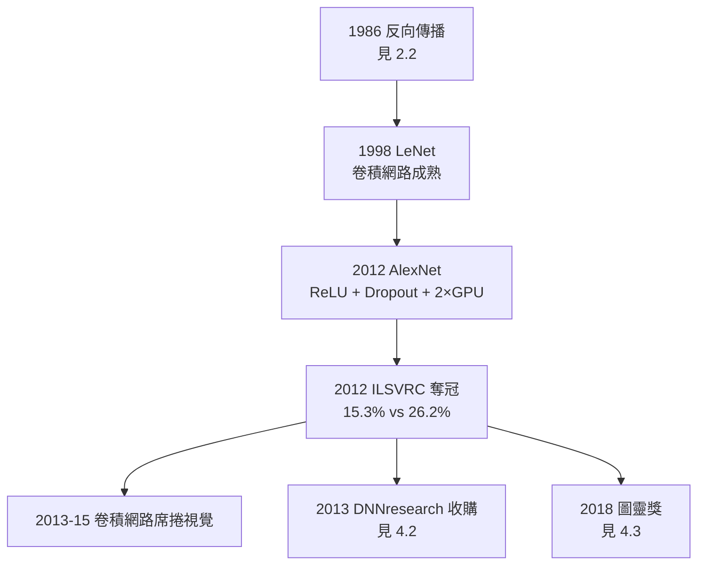

# 4.1 AlexNet（2012）

2012 年 10 月，ImageNet 大規模視覺識別挑戰賽（ILSVRC）結果揭曉：多倫多大學的 AlexNet 以 **15.3%** 的 top-5 錯誤率奪冠，比第二名（26.2%）低了整整十個百分點——在歷屆差距只有一兩個百分點的競賽史上，這是斷崖式的勝利。這一年被普遍視為深度學習時代的元年，而網路的名字來自它的作者：亞歷克斯·克里澤夫斯基（Alex Krizhevsky），在導師辛頓與 Ilya Sutskever 合作下完成。

## 賽前態勢

ImageNet 競賽的規則與歷史：

- 李飛飛團隊 2009 年發布 ImageNet：1400 萬張標註圖像、2 萬餘類別；2010 年起舉辦年度競賽，1000 類、120 萬張訓練圖；
- 2010、2011 年的冠軍都是傳統方法：手工設計特徵（SIFT、LBP）＋支援向量機；
- 電腦視覺學界的主流共識：神經網路「理論上有趣，實務上不行」；
- 辛頓團隊賽前的預期也不高——他們只報名了兩個 GPU，學生的目標是「進前五就好」。

## AlexNet 的構成

AlexNet 的每一個設計都是三十年的積累（見 2.2、3.3）：

- **卷積結構**：繼承福島邦彥的 Neocognitron（1980）與 LeCun 的 LeNet（1989–98）——局部感受野、權重共享、層層抽象；
- **ReLU 激活函數**：替換 Sigmoid，緩解梯度消失，訓練快數倍；
- **GPU 訓練**：Krizhevsky 手寫 CUDA，用兩張 GTX 580 並行訓練——「湯普森路演」籌來的算力（見 3.3）；
- **Dropout**：訓練時隨機丟棄一半神經元，防止百萬參數在百萬圖像上過擬合——這是辛頓本人 2012 年提出的正則化技術；
- **資料增強**：平移、翻轉、色彩擾動，憑空擴充資料；
- 網路共 8 層、約 6 千萬參數——以當年標準是龐然大物。

## 那一天學界醒來

2012 年的結果揭曉後的連鎖反應，是學術史少有的即時性：

- **視覺學界的集體轉向**：2013 年的競賽，前二十名幾乎全用深度網路；手工特徵在兩年內被整體淘汰；
- **計算機視覺元老的反應**：長期反對神經網路的學者公開承認路線錯誤；朱迪亞·珀爾式的因果圖方法與諸多正統讓位；
- **矽谷的搶人潮**：Google、Facebook、百度競相出價邀請辛頓團隊——一場競價（見 4.2）；
- **深度學習成為顯學**：NIPS、CVPR 的錄取率與主題一夜變天，2015 年後「深度」成為每篇論文的關鍵詞；
- 辛頓本人說：「我們沒有改變 ImageNet 的技術，我們改變的是**人們對什麼是可能的的看法**。」

## Dropout 的哲學

AlexNet 的成功技術中，最「辛頓」的是 Dropout：

- 隨機刪除一半單元再訓練——網路被迫不依賴任何單一神經元的組合，每個特徵必須在多種上下文中都有用；
- 這明確來自他的生物學直覺：大腦經常隨機丟失神經元（每分鐘都有），但功能照常運轉——**冗餘與分散**正是 1981 年分散式表徵報告的主題（見 1.3）；
- 它也反駁了符號主義者的「不可讀」攻擊（見 2.3）：辛頓不打算讓網路可讀，他打算讓網路**像生物一樣容錯**；
- Dropout 後來成為深度學習的標配正則化之一，也是辛頓少數直接以生物類比落地的發明。

## 事件關聯與前因後果

| 年份 | 事件 | 後續影響 |
|------|------|----------|
| 2009 | ImageNet 資料集發布 | 決戰戰場確立（見 3.3） |
| 2012-06 | AlexNet 提交，錯誤率 15.3% | 深度學習時代的引爆點 |
| 2012-10 | 競賽結果公開，差距 10.9% | 視覺學界集體轉向 |
| 2012-12 | Dropout 論文發表 | 正則化標配；生物啟發設計的證明 |
| 2013 | 團隊被競價收購；學生四散巨頭 | 學術→產業的人才遷徙（見 4.2） |

**因果**：AlexNet 不是單點發明，而是四十年因果鏈的收口——赫布的學習直覺（1949）→ 約束鬆弛（1978）→ 分散式表徵（1981）→ 反向傳播（1986）→ 對比散度與深度可行（2002–2006）→ GPU 路演（2007–2011）→ 2012 年的斷崖勝利。它也完成了與符號 AI 的最終決戰：明斯基 1969 年宣判的「多層無望」，在 2012 年被徹底反轉——巧合的是，同年 1 月明斯基本人出席了辛頓的演講，並表示神經網路的復興是好事。這場橫跨半世紀的路線之辯，以大資料與梯度下降的全面勝利告終。

### 圖靈之願的兌現

用圖靈 1950 年的框架看（→ 詳見《圖靈傳記》第 4 章），AlexNet 兌現了「兒童機器」路線的第一階段：機器不是被灌輸規則，而是**像孩子看世界一樣，自己從資料中長出視覺概念**。AlexNet 的第一層學到的邊緣偵測器，與生物視覺皮層 V1 區的簡單細胞驚人相似——學出來的表徵，與演化出來的表徵，在數學上趨同。

## 小結

- AlexNet（2012）＝卷積網路＋ReLU＋Dropout＋雙 GPU，以十個百分點的斷崖差距贏得 ImageNet；
- 它是四十年連結主義因果鏈的收口，也是神經網路對手工特徵、對符號 AI 的終審判決；
- Dropout 體現辛頓的生物學直覺：冗餘、分散、容錯；
- 學界與產業的連鎖反應在數月內完成：視覺學界轉向、矽谷搶人、深度學習成為顯學；
- 下一步是現實問題：一個五十九歲（2012 時六十五歲）的教授如何處理矽谷的競價（見 4.2）。
