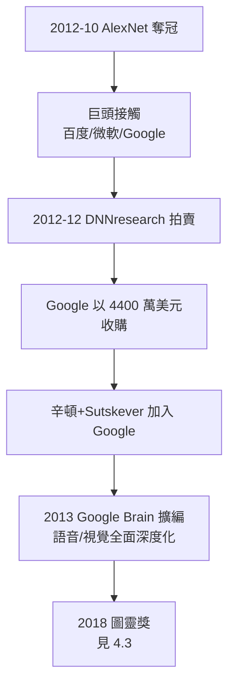

# 4.2 DNNresearch 收購與 Google Brain（2013）

2012 年 12 月，哈瓦那附近的 NIPS 大會上，發生了一樁學術史上罕見的交易：一家**沒有產品、沒有員工（除創辦人外）、甚至沒有網站**的公司，被科技巨頭們公開競價。競價標的是辛頓與他的兩個學生——Alex Krizhevsky 與 Ilya Sutskever。這就是 DNNresearch 的故事。

## 競價的始末

AlexNet 奪冠後（見 4.1），矽谷的反應快得驚人：

- 百度、微軟、Google 都先後接觸辛頓團隊；辛頓自己的說法是「我們對經營公司一竅不通，於是決定……成立一家公司，然後把它賣掉」；
- 2012 年 12 月，辛頓與兩個學生在內華達州哈瓦那湖畔的酒店房間裡，用律師建議的方式舉行**拍賣**：各巨頭以電子郵件競價，輪次加價；
- 競價一路推高：百度出到 1200 萬美元，Google 與微軟糾纏其後，最終 Google 以約 **4400 萬美元**買下 DNNresearch；
- 條款設計保護了學生：Krizhevsky 留在多倫多完成博士，Sutskever 與辛頓加入 Google；
- 辛頓事後的總結帶著他一貫的幽默：「我六十五歲，這筆錢改變了我老年時需要就醫的品質。」（他當時已知自己有視網膜退化等健康問題。）

## Google Brain 與矽谷的深度化

辛頓加入的是一個正在自我重塑的 Google：

- 2011 年，吳恩達與 Jeff Dean 已創立 Google Brain 的前身「谷歌大腦計畫」（Google X 的神經網路實驗）；辛頓 2013 年加入後，深度學習在 Google 的地位實質性升格；
- **2013 年，Google 全線改用深度學習**：語音辨識（Android）、圖片搜索、YouTube 推薦相繼替換為神經網路系統——以往數年的漸進升級，被壓縮成一年；
- 辛頓在 Google 的頭銜是研究科學家，他每年在多倫多與加州之間分配時間，保留多倫多大學教職；
- 同期的人才大遷徙：LeCun 2013 年執掌 Facebook AI 研究院，Bengio 執掌蒙特婁學習演算法研究所（MILA）——AlexNet 的三位作者後來分別成為三大巨頭的旗手；
- **Sutskever 在 Google 之後的軌跡**：2015 年加入 OpenAI 共同創辦團隊，後任首席科學家——AlexNet 一脈成為整個 2020 年代 AI 的地質斷層帶。

## 競價的深層意義

DNNresearch 事件是 AI 史上的一個體制轉折點：

- **學術→產業的人才遷徙開始**：此後十年，頂尖 AI 研究者幾乎被巨頭用學術薪資十倍的價格吸走，大學越來越難留住導師級人物；
- **算力霸權確立**：深度學習的成功證明了算力就是研究能力——只有巨頭養得起 GPU 叢集，研究重心從大學移向企業實驗室；
- **開源與封閉之辯**：2015 年 Google 開源 TensorFlow 部分對沖了封閉趨勢，但「資料＋算力＋人才」的三位一體優勢已不可逆；
- 辛頓本人對遷徙的評價是雙面的：他樂見技術被大規模應用，但晚年承認**「我們創造了一個我們不理解、也控制不住的東西」的時代正是從那時開始**（見 5.2）。

## 事件關聯與前因後果

| 年份 | 事件 | 後續影響 |
|------|------|----------|
| 2012-10 | AlexNet 奪冠（見 4.1） | 巨頭競價的導火索 |
| 2012-12 | DNNresearch 以 4400 萬美元售予 Google | 學術人才市場價格體系確立 |
| 2013 | 辛頓、Sutskever 加入 Google | Google 全線深度化 |
| 2013–15 | LeCun 進 Facebook、MILA 擴張 | 三大陣營鼎立的學術地圖 |
| 2015 | Sutskever 轉戰 OpenAI | 通向大模型時代（見 5.2） |

**因果**：DNNresearch 的競價是一個象徵性事件：**六十餘年來第一次，符號 AI 的繼承人們（矽谷）向連結主義的老兵（辛頓）支付了巨額賠償金**。這筆錢買下的不只是一個團隊，而是路線的定標權。2013 年之後，「AI 進展」的定義權由深度學習壟斷——在 1980 年代 CMU 的走廊裡輸掉辯論的辛頓（見 2.3），此時成為整個產業的理論正統。而他晚年對此的全部反思，都源於這個勝利太徹底：勝利者失去制衡（見 5.2）。

## 小結

- DNNresearch 競價（2012–2013）以 4400 萬美元收場，Google 勝出；辛頓與 Sutskever 入 Google，Krizhevsky 留校；
- 2013 年 Google 全線深度化，成為產業深度學習化的標誌性年份；
- 學術人才向產業的歷史性遷徙自此啟動，算力霸權確立；
- AlexNet 一脈的學生們執掌了此後十年 AI 的主要陣營；
- 勝利之後是加冕：2018 年，辛頓與 LeCun、Bengio 共同獲得圖靈獎（見 4.3）。
