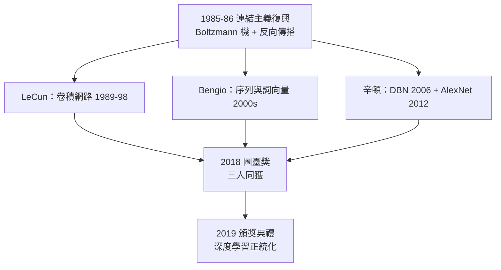

# 4.3 圖靈獎（2018）

2018 年 3 月 27 日，ACM 宣布：**2018 年圖靈獎**——電腦科學的最高榮譽，以計算機科學之父命名（→ 詳見《圖靈傳記》全書）——頒給三位連結主義者：**辛頓、楊立昆（Yann LeCun）、班吉奧（Yoshua Bengio）**，理由是「概念與工程上的突破，使深度神經網路成為計算的關鍵組成部分」。獎項於 2019 年 6 月在舊金山頒發。

## 三人各自的貢獻

ACM 的頌詞把三人視為一個共同體，但分工清晰：

| 人物 | 核心貢獻 | 所在機構 |
|------|----------|----------|
| 辛頓 | 反向傳播的復興與推廣（1986）、Boltzmann 機（1985）、DBN 與深度學習復興（2006）、AlexNet（2012）、Dropout | 多倫多大學 / Google |
| LeCun | 卷積網路（1989–98）、手寫數字識別的工程化、反向傳播的視覺應用 | 紐約大學 / Facebook AI |
| Bengio | 序列建模、詞向量與語言的分散式表徵、注意力機制的先驅工作（2014）、MILA 學派 | 蒙特婁大學 |

- 三人的共同點：都是在凜冬中堅持神經網路的人——辛頓的凜冬最長（1970–2006，見 1.2、3.1），LeCun 在貝爾實驗室解體後一度失業，Bengio 在蒙特婁默默耕耘二十年；
- 三人的傳承譜系也同源：辛頓是魯梅爾哈特的同盟（見 1.3）；Bengio 是辛頓的博士後（1991 前後曾在 MIT 與貝爾實驗室，受辛頓—LeCun 影響）；LeCun 則是辛頓博士後時期的同事，1985 年在辛頓的辦公室裡第一次聽到反向傳播的構想；
- 評審的潛台詞再明顯不過：**圖靈獎史上第一次，頒給了一條被主流否定過的路線**——這是對 1969 年《感知器》事件的歷史平反。

## 「深度學習三巨頭」

獲獎使「深度學習三巨頭」（Godfathers of Deep Learning）的稱號定型：

- 2015 年三人與吳恩達、Schmidhuber 等共同簽署過 AI 開放信；2018 年後他們的公開言論具有近乎政策文件的分量；
- 三人對 AI 風險的立場各異且分歧公開化：Bengio 最早轉向安全倡議；LeCun 長期駁斥「滅絕論」，主張 AI 風險被誇大；辛頓則在 2023 年完成了最戲劇性的轉變（見 5.2）——**三巨頭的分歧本身就是 AI 治理辯論的縮影**；
- 2018 年 11 月辛頓在一場峰會上把三人並置時說：「我們三個人幾乎從來沒有同時相信過同一件事，我們只是都相信了符號 AI 是錯的。」

## 得獎的重量

這座獎對辛頓的意義需要放進他的家族史中讀：

- 獎以圖靈命名——他畢生對抗的圖靈測試傳統、他繼承的圖靈「兒童機器」設想（→ 詳見《圖靈傳記》第 4 章），在獎章上合而為一；
- 獲獎演說與相關專訪中，辛頓反覆回到兩個主題：**「我們需要新的計算機」**（他認為數位電腦上模擬神經網路是臨時的，未來屬於模擬硬體—— mortality/immortal computation 的設想）與**「我們仍不理解大腦」**——獲獎者的發言像一個研究者，而非一個勝利者；
- 他還提到一個私人細節：得知獲獎當天，他的第一反應是不相信，第二反應是想起了母親——她曾在他被學界拒絕的年代裡始終相信他。

## 事件關聯與前因後果

| 年份 | 事件 | 後續影響 |
|------|------|----------|
| 1985–86 | Boltzmann 機與反向傳播（見 2.1、2.2） | 三人共同的技術起點 |
| 1998 | LeCun LeNet 的工程成熟 | 卷積網路的工業範本 |
| 2006 | DBN 復興（見 3.2） | 三人重新聚攏於「深度」旗幟 |
| 2012 | AlexNet（見 4.1） | 勝利使圖靈獎不可避免 |
| 2018-03 | 三人共獲圖靈獎 | 深度學習成為計算機科學正統 |
| 2024-10 | 辛頓再獲諾貝爾物理學獎 | 史上首位雙冠（見 5.3） |

**因果**：2018 年圖靈獎是 2012 年 AlexNet 的制度化追認——學界用最高獎項確認：**表徵應該被學習，不應該被設計**。這一判決同時是對一整個世紀哲學爭論的裁決：弗雷格—羅素—卡爾納普的邏輯主義傳統（→ 詳見《弗雷格傳記》《羅素傳記》《卡爾納普傳記》）試圖用形式系統窮盡思想，而圖靈獎此刻授予的是它的反面——思想從經驗中以向量形式湧現。耐人尋味的是，辛頓本人在受訪時拒絕了「勝利」的敘事：「我們只是發現了大腦一直在用的方法的一部分。」六年後，諾貝爾委員會將再給他一次表達這種謙遜的機會（見 5.3）。

## 小結

- 2018 年圖靈獎授予辛頓、LeCun、Bengio，是連結主義的歷史平反與深度學習的正統化；
- 三人是同一場凜冬的三位倖存者，傳承譜系交織（LeCun 曾是辛頓的博士後同事，Bengio 曾是辛頓的博士後）；
- 三巨頭其後在 AI 風險問題上的公開分歧，成為 AI 治理辯論的座標系（見 5.2）；
- 辛頓的得獎感言仍是研究者口吻：新的計算機、未解的大腦；
- 而在獎項的光環之下，他內心真正的問題從未變過：**反向傳播不是大腦的工作方式，那大腦是怎麼工作的？**——這個問題把他引向 Capsule 與 GLOM（見 5.1）。
