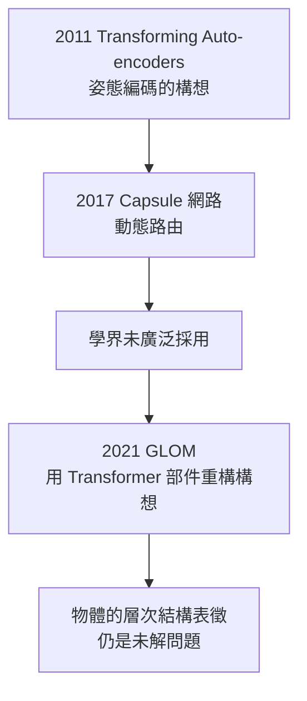

# 5.1 Capsule 網路與 GLOM（2011–2021）

在獲得世界級榮譽（見 4.1–4.3）之後，辛頓做了一件罕見的事：**把聲望投注在自己最不成熟的想法上**。2011 年起，他重拾一個困擾了電腦視覺數十年的老問題——卷積網路的根本缺陷——並提出兩代解法：Capsule 網路（2017）與 GLOM（2021）。這是他「理解大腦」本命的代表作，也是他晚年最孤獨的第二條戰線。

## 卷積網路的根本缺陷

AlexNet 的勝利（見 4.1）沒有讓辛頓滿意，他始終認為卷積網路（CNN）有原理性的錯：

- CNN 的池化（pooling）犧牲了**空間關係**：它知道圖裡「有一隻眼、有一個鼻」，卻不知道相對位置——因此一張把五官錯位的臉也會被認成人臉；
- 這就是他常舉的例子：把一張臉的嘴巴畫在眼睛上方，CNN 照樣高分；
- 更深一層：CNN 用固定的座標框架處理視角變化，只能靠大量資料「背誦」各種旋轉縮放，而**人類用座標變換就解決了**——這正是查爾斯·辛頓（見 1.1）一生著迷的四維直觀問題在視覺上的重現；
- 這個缺陷在大模型時代依然存在（物體的部件—整體層次結構如何表徵），辛頓稱之為電腦視覺未竟的工程。

## Capsule 網路

2011 年辛頓先提出思路（〈Transforming Auto-encoders〉），2017 年與學生 Sabour、Frosst 在 NeurIPS 發表〈Dynamic Routing between Capsules〉：

- **Capsule＝一組神經元**，其活動向量同時編碼「實體的存在機率（向量長度）」與「實體的姿態參數（向量方向）」；
- **動態路由**：低層 capsule 向高層 capsule「投票」，投票一致的方向被加強——用「共識機制」取代池化，保留空間關係；
- 訓練仍用反向傳播（見 2.2），但表徵哲學是全新的：**實體＝姿態矩陣的層次組合**；
- 實驗結果：在 MNIST 重疊數字分割等任務上顯著優於 CNN，但在 ImageNet 規模上未能取代主流——工程社群最終未跟進。

## GLOM：晚年最大的賭注

2021 年，辛頓發表〈How to represent part-whole hierarchies in a neural network〉，提出 GLOM（取自 glom together，聚成一團）架構：

- 核心問題：一張場景裡「鼻子屬於臉、臉屬於人」的**部件—整體層次**，如何在固定數量的神經元中以分散式方式表徵（見 1.3）？
- GLOM 的答案：在同一位置的多個層次（物件/部件/子部件）上各自維護一個嵌入向量；**相同身分的相鄰嵌入互相吸引**，形成「島嶼」——用 Transformer 的注意力（見 5.2 時代背景）實作動態路由的老構想；
- 辛頓自述 GLOM 是他「三十年來對神經網路架構思考的總和」，並坦言**自己不知道它能不能成**——他把論文當作邀請函而非宣言：「我把它公之於眾，是因為我老了，需要年輕人接手。」

## 兩條戰線的分工

晚年辛頓的學術人格一分為二：

| | 工程戰線 | 大腦戰線 |
|---|---|---|
| 立場 | 深度學習的締造者與辯護者 | 反向傳播不是大腦的工作方式 |
| 代表工作 | AlexNet、反向傳播的推廣 | Capsule、GLOM、「mortal computation」 |
| 目標 | 讓機器有用 | 理解智慧本身 |
| 命運 | 全面獲勝（見 4.1–4.3） | 至今未獲主流跟進 |

- 他多次表示：反向傳播在生物上不合理（見 2.2），大腦可能用某種近似的、局部的學習機制——找到它才是真正的問題；
- 2016 年前後他提出「mortal computation」：知識與硬體不可分離的計算（像大腦一樣，拷貝不走的知識）——數位計算的「不朽」以能量為代價，生物計算的「必死」以效率為報酬；
- 這條戰線與 Capsule/GLOM 一體：都是「機器學習應該更接近大腦」的堅持。

## 事件關聯與前因後果

| 年份 | 事件 | 後續影響 |
|------|------|----------|
| 2011 | Transforming Auto-encoders | 姿態編碼構想首發 |
| 2017 | Capsule 網路（動態路由） | 保留空間關係的嘗試；未成主流 |
| 2021 | GLOM 論文 | 部件—整體層次的公開懸賞 |
| 2023 | 離開 Google（見 5.2） | 自由發表對大腦與風險的觀點 |
| 未決 | 層次表徵問題 | 下一代架構的候選答案之一 |

**因果**：Capsule 與 GLOM 的前因深植於兩處：其一是家族——查爾斯·辛頓的四維直觀（見 1.1），在孫輩手上變成「用座標系解耦視角與身分」的工程主張；其二是他六十年的表徵哲學（見 1.3、2.2）——分散式表徵的下一個必答題就是結構：**向量如何組合成物體、物體如何組合成世界**。工程界的不跟進沒有動搖他：AlexNet 曾經也被視為異端（見 3.1）。但這一次，歷史沒有在他有生之年給出裁決——而他 2023 年選擇離開 Google，正是為了在無所顧忌的狀態下繼續說真話（見 5.2）。

## 小結

- Capsule 網路（2017）用活動向量同時編碼存在與姿態、用動態路由取代池化——對 CNN 原理缺陷的正面進攻；
- GLOM（2021）用注意力實作部件—整體層次的分散式表徵，是辛頓三十年架構思考的總和；
- 「工程戰線大勝、大腦戰線孤軍」的晚年分工，延續了他與主流永遠錯位的節奏；
- mortal computation 的構想把「理解大腦」與「重新設計計算機」合而為一；
- 就在這條戰線推進之際，2023 年一則新聞震動世界：辛頓辭去 Google 職務，公開警告 AI 風險（見 5.2）。
