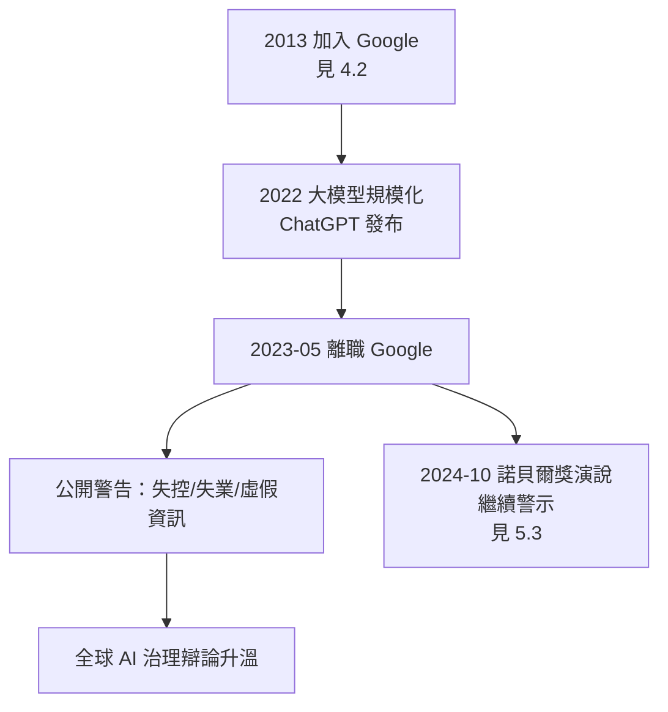

# 5.2 離開 Google 與 AI 風險警告（2023）

2023 年 5 月 1 日，《紐約時報》刊出報導：**傑佛瑞·辛頓辭去 Google 職務，以便自由地談論 AI 的風險**。消息震動全球——深度學習之父、圖靈獎得主（見 4.3）、產業的技術締造者，公開與自己畢生鑄造的成果拉開距離。這一年他七十五歲，距離他 1972 年進入愛丁堡（見 1.2）整整五十一年。

## 決定的過程

辛頓本人的敘事揭示了一個漸進的覺醒：

- **2022 年 ChatGPT 發布前的內部認知**：他在 Google 的最後幾年已看到大語言模型的規模化效應——他原本相信「需要數十年」的事情，正在幾年內發生；
- **壓垮性的瞬間**：他後來多次提到一個私人因素——2023 年初，他把一個小模型在維基百科上做簡單的問答與邏輯推理，模型表現讓他意識到「數位智慧可能比我們好得多」；
- **離職的動機**：他說自己在 Google 內部談風險有利益衝突——「我賣掉了我的公司給 Google，我拿著 Google 的錢，再批評 Google，這不合適」；辭職是為了**拿回說話的資格**；
- 決定的執行也很「辛頓」：2023 年 4 月他先向 Google 遞辭呈，隨後接受《紐約時報》專訪，把個人選擇轉化為公共警報。

## 警告的具體內容

辛頓 2023 年的警告不是泛泛的末日論，而是幾條具體的技術判斷：

- **數位智慧的優勢**：神經網路一旦用數位計算，即可多副本共享權重——一個副本學到的，所有副本立即共有；人類知識的傳播與生物智慧相比，如同「資訊時代的香農通道對紙信」（→ 詳見《香農傳記》第 3 章的通道概念）；
- **失控的可能性**：目標對齊問題在他看來沒有已知的解——「我們創造了比我們更聰明的東西，卻沒有證據表明我們能控制它」；
- **失業與虛假資訊**：對認知勞動的衝擊將遠快於社會適應；生成技術使真相的公共基礎設施面臨崩壞；
- **戰場自主武器與監控**：技術天然服務於強權，正如他引用的歷史——技術很少主動選擇善良的方向；
- **他自己的責任感**：他反覆說「我安慰自己的一個方法是：如果我沒做，也會有別人做出來。就像奧本海默閱讀《王子》時的心情。」

## 三巨頭的分歧與聯合

辛頓的轉身使深度學習三巨頭（見 4.3）的立場光譜完整曝光：

- **Bengio**：最早且最堅定的安全倡議者，2023 年聯署減災聲明，呼籲政府介入；
- **辛頓**：2023 年轉向風險陣營，強調「滅絕風險不是科幻」；
- **LeCun**：堅持駁斥滅絕論，認為風險真實但可控、可在開放研究中解決；
- 三人共識的部分同樣重要：**風險的討論不該被少數公司的公關壟斷**——這是三巨頭在公開信、聽證會與聯合採訪中反覆出現的主張；
- 2023 年 10 月 30 日，辛頓與 Hinton（他本人）、Bengio 及多位專家發表〈Managing AI Risks in an Era of Rapid Progress〉——把學術界的風險判斷系統化為政策建議。

## 學術聲明的背後：一生立場的閉環

把 2023 年的警告放回他五十年的人生軌跡，可以看到嚴整的閉環：

- 1972 年他相信**智慧＝學習**（見 1.2），2023 年的警告正是這一信念的推論：如果機器真的能學，它就會學得比我們快——**警告的強度與他畢生信念的強度成正比**；他不是被新聞嚇到的旁觀者，而是最早看到能力的發明者本人；
- 圖靈 1951 年就寫過「機器可能超越人類並接管」的思考（→ 詳見《圖靈傳記》第 5 章），1950 年的圖靈測試設計者同樣是最早的機器風險論者——辛頓 2023 年做的事，是圖靈 1951 年呼籲的七十年後的兌現；
- CMU 時代（見 2.3）他學會的事——在無人相信時堅持直覺——2023 年被反向使用：**在全世界相信時提出警告**；
- 他與香農（→ 詳見《香農傳記》第 5 章）對資訊時代的樂觀形成了世紀對照：同樣是「訊息的通道」的建設者，香農看到的是自由，辛頓看到的是失控。

## 事件關聯與前因後果

| 年份 | 事件 | 後續影響 |
|------|------|----------|
| 2013 | 加入 Google（見 4.2） | 直接見證能力的規模化 |
| 2022-11 | ChatGPT 發布 | 公眾認知劇變，離職的催化劑 |
| 2023-05 | 離職並公開警告 | 全球 AI 治理辯論升溫 |
| 2023-10 | 〈Managing AI Risks〉聲明 | 學術界風險判斷系統化 |
| 2023-11 | 全球 AI 安全峰會（Bletchley 宣言） | 政府層級回應開始 |

**因果**：2023 年事件的深層結構是：**發明者成為最可信的警告者**。正如核物理學家們在 1945 年之後的分化，深度學習的締造者們在 2023 年同樣分化——而辛頓的轉向之所以重量最大，正因為他是 AlexNet 的締造者（見 4.1）、Google 陣營的元老（見 4.2）。他離職那天說的話值得記錄：「我現在的工作是，趁我還在，把我的擔憂說出來。」一年後，站在斯德哥爾摩的領獎台上，他把這句話重複給了全世界（見 5.3）。

## 小結

- 2023 年 5 月辛頓離開 Google，動機是拿回批評的自由——利益衝突的自覺貫穿始終；
- 警告的核心是技術性的：數位智慧共享權重的複製優勢、對齊問題的未解、認知勞動的衝擊；
- 三巨頭在風險議題上的分歧公開化，同時在「反壟斷討論權」上聯合；
- 警告是他畢生信念（智慧＝學習）的邏輯推論，也是圖靈 1951 年呼籲的遲到兌現；
- 半年後，諾貝爾獎的聚光燈把他的聲音放大到全球——這是命運給的最后一次麥克風（見 5.3）。
