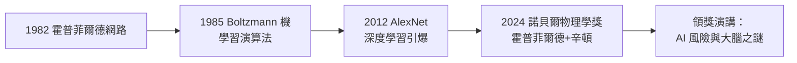

# 5.3 諾貝爾物理學獎與遺產（2024–2026）

2024 年 10 月 8 日，瑞典皇家科學院宣布：**2024 年諾貝爾物理學獎**授予約翰·霍普菲爾德（John Hopfield）與傑佛瑞·辛頓，「以表彰他們透過人工神經網路進行機器學習的基礎性發現與發明」。七十六歲的辛頓成為史上第一位同獲圖靈獎（見 4.3）與諾貝爾獎的電腦科學家——而他獲獎後的頭一句話是：「對不起，我沒想到。」

## 得獎的因果鏈

諾貝爾委員會的授獎理由精確地指向四十年前的工作：

- **霍普菲爾德**：1982 年以統計物理建構聯想記憶網路——能量函數與吸引子（見 2.1）；
- **辛頓**：1985 年前後以 Boltzmann 機實作**學習**——把霍普菲爾德的記憶系統升級為可以從資料中習得結構的系統（見 2.1）；
- 委員會的敘事與本傳記的敘事完全同構：**1982–1985 年的統計物理—神經網路匯流，是整條深度學習血脈的起點**；
- 物理學獎頒給 AI 的正當性在委員會的說法中：人工神經網路的學習機制本身即是統計物理的成就——機率、能量、退火，這些物理概念在神經網路中獲得了新的生命；
- 頒獎典禮上辛頓的演講沒有講 AlexNet，沒有講反向傳播，而是講了**GLOM、mortal computation 與 AI 風險**——他把諾貝爾獎當作了預警系統的擴音器。

## 一個意外的電話

獲獎當天的細節廣為流傳：

- 接到瑞典來電時，辛頓正在加州的一家小旅館，電腦故障、聽力退化、電話雜訊嚴重——他起初以為是詐騙電話；
- 得知真獲獎後，他的即時反應被記錄下來：「我震驚，我完全沒有預料到。」並補了一句他的黑色幽默：「沒有人想到神經網路能走到今天，包括我。我常說要關掉再重開（turn it off），現在也许該說：我們沒有關掉它的按鈕了。」
- 他隨即在記者會上把話題立即轉向風險：「**這就像工業革命——只是這一次，是比我們更聰明的東西的誕生。**」
- 記者問他是否後悔發明了這些，他的回答成為經典引文：「我安慰自己：如果沒有我，別人也會做出來。就像奧本海默讀《王子》時的心情。」

## 遺產的第一層：技術血脈

截至 2026 年回望，辛頓留下的技術血脈無所不在：

- **反向傳播**（1986，見 2.2）至今仍是所有深度網路的訓練核心，包括 2020 年代的大語言模型；
- **分散式表徵**（1981，見 1.3）成為整個 AI 的表徵正統：詞向量、嵌入空間、多模態表示皆其後裔；
- **Dropout**（2012，見 4.1）、**深度信念網路**（2006，見 3.2）、**對比散度**（2002）各據要津；
- **能量模型**路線（見 2.1）在擴散模型時代復活——生成式 AI 的數學底層仍是他 1985 年的統計思想；
- 他的學生網絡（Sutskever、Krizhevsky、Dahl 等，見 3.1、4.2）執掌了 OpenAI、產業與學術的主要陣地——**血脈的第三層是人**。

## 遺產的第二層：觀念之爭的裁決

辛頓的一生裁決了一場跨越百年的哲學戰爭：

- 布林的邏輯傳統（他自己的高曾祖父，見 1.1；→ 詳見《布林傳記》）經弗雷格、羅素、卡爾納普（→ 詳見《弗雷格傳記》《羅素傳記》《卡爾納普傳記》）到麥卡錫的符號 AI（→ 詳見《麥卡錫傳記》第 4 章），主張**思想＝形式系統**；
- 辛頓的勝利宣告：**思想＝高維向量空間中的學習表徵**——概念是幾何而非符號，意義是相似性而非定義；
- 維根斯坦後期「意義即使用」的洞見（→ 詳見《維根斯坦傳記》第 4 章）以非預期的方式獲得工程實證：詞向量語義正是「從使用中長出意義」；
- 但辛頓本人拒絕把勝利說成符號路線的死亡——他晚年承認大模型正在重新湧現出類符號行為，而「符號與向量的結合」可能是最後的答案；
- 家族敘事的閉環在此完成：布爾代數統治了數位計算機（香農，→ 詳見《香農傳記》第 2 章），布林的玄孫統治了學習機器——**兩位後裔，各執半壁江山**。

## 遺產的第三層：科學家的姿態

辛頓留給科學文化的姿態遺產同樣清晰：

- **五十年的孤獨**：1970–2006 年近無人喝彩的堅持（見 1.2、3.1），成為科學史「直覺對抗主流」的教科書案例；
- **失敗優先的研究文化**（見 3.1）經由他的學生擴散為現代機器學習實驗室的通用規範；
- **發明者的自省**：2023 年離職（見 5.2）與 2024 年領獎演講構成一個完整的姿態——**技術的成功不豁免責任，反而是責任的來源**；
- 他 2024 年後的公開日程幾乎全部投入 AI 安全倡議與大腦機制的最後追問（GLOM 與 mortal computation，見 5.1）——一隻手敲警鐘，一隻手還在解謎。

## 事件關聯與前因後果

| 年份 | 事件 | 後續影響 |
|------|------|----------|
| 1982–85 | 霍普菲爾德網路＋Boltzmann 機（見 2.1） | 獲獎的直接理由 |
| 2018 | 圖靈獎（見 4.3） | 成為雙冠得主的必要前提 |
| 2023 | 離職與風險警告（見 5.2） | 諾獎演講的議程基礎 |
| 2024-10 | 諾貝爾物理學獎 | 雙冠；AI 的科學正統最終確立 |
| 2024–2026 | AI 安全倡議＋大腦研究 | 晚年遺產的雙主線 |

**因果**：2024 年諾貝爾獎的最深意義，是對「**統計物理—神經網路—深度學習**」這條四十年因果鏈的官方追認——而鏈條的兩端，1982 年的霍普菲爾德與 1985 年的辛頓，正是委員會選中的兩個節點。若把視野放寬：這條鏈與香農的資訊論（→ 詳見《香農傳記》第 3 章）、圖靈的學習機器設想（→ 詳見《圖靈傳記》第 4 章）、麥卡錫在達特茅斯命名的學科（→ 詳見《麥卡錫傳記》第 4 章）共同構成二十世紀 AI 的完整系譜——而辛頓站在系譜的終端，也站在新紀元的門檻上。他 2024 年說的最後一句獲獎相關名言，可以被當作本傳記的結語：「**我畢生都在研究大腦如何學習。我從未想到，我研究的東西會比我更聰明。**」

## 小結

- 2024 年諾貝爾物理學獎（與霍普菲爾德）追認的是 1982–1985 年統計物理—神經網路的匯流，而非 AlexNet 的工程勝利；
- 辛頓成為圖靈獎＋諾貝爾獎雙冠第一人，AI 的科學正統至此定案；
- 技術遺產（反向傳播、分散式表徵、能量模型）構成 2026 年 AI 的底層地質；
- 觀念遺產是對百年邏輯主義的裁決：意義在幾何之中、在學習之中——同時為符號與向量的和解留下門縫；
- 姿態遺產是發明者的自省：勝利之後說真話，警鐘長鳴而不停止解謎——這就是傑佛瑞·辛頓，布林的玄孫、圖靈的信徒、深度學習的父親。
