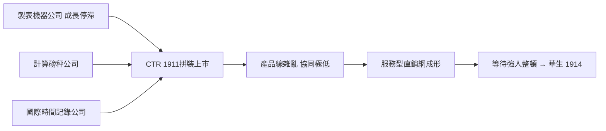

# 1.2 CTR 三公司合併（1911-1914）

1911 年，金融掮客查爾斯·弗林特以約 230 萬美元資本，將三家毫不相干的公司拼裝成計算製表記錄公司（Computing-Tabulating-Recording Company, CTR）：霍勒瑞斯的製表機器公司、日頓的計算磅秤公司（Computing Scale Company of America）、恩迪科特的國際時間記錄公司（International Time Recording Company，做打卡鐘與切肉機）。

這是一次典型的「托拉斯拼盤」：三家公司的產品線幾無協同——打孔卡、磅秤、考勤鐘，唯一的共同點是都向企業銷售「計量設備」，且都採用出租與維修服務模式。弗林特的目的不在技術整合，而在財務操作：合併、上市、套現。他找來的總經理毫無製造業熱情，CTR 初期營收約 400 萬美元，獲利微薄，組織鬆散。

但這個雜牌拼盤意外具備了後來 IBM 的兩個基因：第一，以企業客戶為對象的直銷與維修服務網；第二，多角化產品線提供的現金流緩衝，讓打孔卡業務得以度過景氣波動。若沒有磅秤與時鐘業務撐住早期營收，製表機部門未必能活到華生接手。混亂的 CTR，恰好是一塊等待強人來整形的璞玉。

### 因果鏈

前因是霍勒瑞斯的技術鎖定加上經營瓶頸，遇上弗林特的金融拼盤動機，催生了 CTR；後果是 CTR 雖大而不強，反而練出了一支企業直銷維修隊伍與穩定的現金流結構。這個「有通路、無靈魂」的狀態，正是 1914 年湯瑪斯·華生（Thomas Watson Sr.）得以入主並徹底改造它的前提——沒有 CTR 的爛攤子，就沒有華生的舞台。
