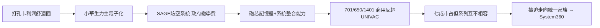

# 2.1 SAGE 與進軍電子計算機（1950-1964）

1950 年代初，IBM 仍沉浸在打孔卡利潤中，真正的電子計算機先驅是 ENIAC、UNIVAC 背後的雷明頓蘭德（Remington Rand）與一眾新創。小華生（Thomas Watson Jr.）力排眾議，說服老華生投入鉅資研發國防與商用電腦，關鍵轉捩點是韓戰與冷戰催生的半自動地面防空系統 SAGE。

SAGE 是美國空軍的防空電腦網，IBM 拿下核心生產合約，在 1950 年代製造了數十台噸級真空管巨獸。這個「賠本賺吆喝」的軍方訂單，實質是美國政府替 IBM 繳了學費：數千名工程師學會了磁芯記憶體、即時運算與大型系統整合。學成之後，IBM 把軍規技術轉為商規，1952 年推出 701、1954 年 650 磁鼓機大賣，1959 年全電晶體化的 1401 系列橫掃中小企業，奪回被 UNIVAC 搶走的王座。

到 1960 年代初 IBM 已拿下美國電腦市場約七成，但產品線卻陷入混亂：1401、7090、7040 等六、七個互不相容的系列各自為政，軟體無法通用，客戶升級等於重寫程式。壟斷帶來了規模，也帶來了分裂——要嘛被自己的產品線拖垮，要嘛發動一場壯士斷腕的統一革命。

### 因果鏈

前因是打孔卡壟斷造成的路徑依賴，若無冷戰軍費與小華生的執拗，IBM 可能錯過電子化列車；SAGE 訂單正是把「國防需求」轉化為「商業能力」的橋樑。後果是 IBM 雖重奪龍頭，卻掉進自己製造的相容性泥沼——1401 的成功反而讓統一更困難，因為每個產品線都有既得利益者。這個矛盾直接引爆 1964 年史上最大膽的產品豪賭：System/360。
