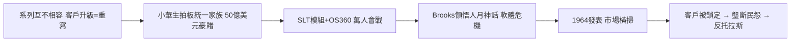

# 2.2 System/360 相容家族革命（1964-1965）

1964 年 4 月 7 日，IBM 發表 System/360：一個涵蓋大中小六款機型、軟體完全向上相容的「電腦家族」。客戶從小機器升級到大機器，程式不需重寫；週邊設備、作業系統 OS/360 通用。這在今天稀鬆平常，在當時是離經叛道的革命——此前全業界（包括 IBM 自己）都是每款機器各自獨立。

豪賭的代價是天文數字：研發耗資約 50 億美元（相當於當年 IBM 年營收的兩倍以上），新建六座工廠、改用積體電路的前身 SLT 模組。專案由弗雷德·布魯克斯（Fred Brooks）等人領導，人力一度膨脹到上萬人，軟體進度失控的慘痛經驗後來被寫成經典《人月神話》（The Mythical Man-Month）：「向延遲的專案加人，只會讓它更延遲」。

結果是商業史上最成功的產品發表之一。到 1960 年代末，360 系列佔據全球中大型電腦市場壓倒性份額，IBM 年營收從 1963 年約 30 億美元翻倍成長，競爭對手被貶為「白雪公主與七個小矮人」。但相容家族也把客戶徹底鎖進 IBM 生態，租金與軟體綁售引發眾怒，為下一節的反托拉斯大戰埋下導火線。

### 因果鏈

被前因驅動：若無 1401 等機種造成的分裂之痛，就不會有統一家族的決心；若無打孔卡時代累積的現金與 SAGE 練出的系統能力，也賭不起 50 億美元。引發的後果同樣巨大：技術上確立了「相容性」作為電腦產業的鐵律，商業上把 IBM 推上 $70\%$ 市占的帝王寶座，法律上卻因贏得太多、綁得太緊而成為司法部眼中的壟斷巨獸。勝利與訴訟，是同一枚硬幣的兩面。
