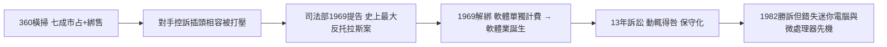

# 2.3 壟斷巔峰與反托拉斯訴訟（1967-1969）

System/360 的成功讓 IBM 成為「藍色巨人」：深藍 logo、深藍西裝、白色襯衫，代表穩定、可信、永不犯錯。1960 年代末 IBM 掌握美國大型電腦市場約七成，毛利率超過 $60\%$ ，競爭者只能在夾縫中求生。IBM 的租賃制與軟硬體綁售（買主機必須搭 IBM 軟體與維修）讓對手指控它以掠奪性租賃打壓插頭相容機（plug-compatible）廠商。

1969 年 1 月 31 日，詹森政府卸任前最後一天，美國司法部對 IBM 提起反托拉斯訴訟，指控其壟斷通用數位電腦市場。這場官司一打就是十三年，調閱了數千萬頁文件，成為美國史上規模最大的反托拉斯案之一。IBM 被迫改變商業行為：1969 年宣布「解綁」（unbundling），軟體與服務開始單獨計價——無意間催生了獨立軟體產業（應用軟體公司、後來的微軟都間接受益）。

諷刺的是，訴訟的漫長反而保護了 IBM：整個 1970 年代，公司以「官司纏身、動輒得咎」為由維持現狀，不敢大舉併購或進入新市場，錯失小型電腦與微處理器的早期浪潮。當 1982 年雷根政府以「無法律依據」撤銷告訴時，IBM 贏了官司，卻輸了時間——PC 革命已經在它眼皮底下爆發。

### 因果鏈

前因正是 360 的巨大成功：相容鎖定越有效，壟斷指控就越有力；司法部的起訴可說是 IBM 自己「贏出來的」。後果則是辯證的：解綁政策意外孵化了軟體產業（這是 IBM 送給對手的第一份大禮），而訴訟陰影造成的保守文化，又讓 IBM 在下一個典範轉移（微電腦）中反應遲鈍。這份遲鈍，直接導致第三章中倉促、妥協的 IBM PC 決策。
