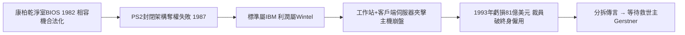

# 3.3 相容機反噬與巨虧（1982-1993）

1982 年，康柏（Compaq）以「合法逆向工程 BIOS」的乾淨室（clean-room）手法推出第一台 IBM 相容攜帶型電腦，鳳凰科技（Phoenix）更把相容 BIOS 卖給所有人。一夕之間，「IBM 相容」變成行業標準，而標準的制定者 IBM 反而成了眾多組裝廠之一。IBM 試圖以 1987 年封閉的 PS/2 與 Micro Channel 架構奪回控制權，市場以腳投票：拒絕為 IBM 的專利租金買單。

主機市場同時崩盤：1980 年代末工作站與 Unix 伺服器、1990 年代初客戶端-伺服器架構興起，企業不再迷信集中式主機，IBM 高價租賃模式土崩瓦解。1991-1993 年 IBM 連續鉅虧，1993 年單年虧損達 81 億美元，創當時美國企業紀錄，股價崩跌，終身僱用制破功，裁員數萬人，媒體出現「IBM 即將被分拆」的預言。

諷刺的對照是：被 IBM 扶植的微軟與 Intel 此時如日中天，市值與利潤雙雙超越老師傅。IBM 發明了 PC 標準，卻只賺到組裝的微薄毛利；平台利潤（作業系統＋晶片）全數外流。這是商業史上最昂貴的一課：**誰控制介面與授權，誰就控制利潤**——IBM 在打孔卡與 360 時代深諳此道，在 PC 時代卻親手忘記。

### 因果鏈

前因正是上一節的開放與非獨家授權：沒有那兩紙合約，就沒有相容機產業；沒有主機傲慢造成的轉型遲緩，PS/2 的奪權也不會如此脫離市場。後果則把 IBM 推到死亡邊緣——連續鉅虧摧毀了「藍色巨人永不犯錯」的神話，也摧毀了分拆論之外的所有幻想。正因為跌到谷底，董事會才敢在 1993 年從公司外部（RJR Nabisco）請來路易·葛斯納（Lou Gerstner），開啟第四章的大象跳舞。
