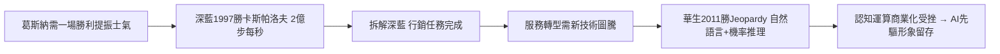

# 4.3 深藍與華生（1997-2011）

1997 年 5 月 11 日，IBM 超級電腦「深藍」（Deep Blue）在紐約與世界棋王卡斯帕洛夫（Garry Kasparov）六番棋決勝局中獲勝，成為首度擊敗現任世界冠軍的電腦。每秒評估約 2 億步棋的暴力搜尋加上大師調參，證明了「 brute force + 領域知識」的可怕威力。卡斯帕洛夫質疑有棋手暗助、要求重賽，IBM 卻功成身退、拆解深藍——因為目的本就不是下棋，而是行銷。

十四年後的 2011 年，問答系統「華生」（Watson，以老華生命名）在益智節目《危險邊緣》（Jeopardy!）擊敗人類冠軍肯·詹寧斯。華生展示的是自然語言理解與機率推理：在海量非結構化文本中找出最可能的答案並敢於下注。IBM 隨即高調推出「認知運算」戰略，宣稱華生將革新醫療、金融與客服。

兩場勝利的因果位置耐人尋味：深藍發生在葛斯納止血之後，功能是提振士氣、宣告「IBM 還能贏」；華生發生在服務轉型完成之際，功能是為轉型中的 IBM 尋找下一個技術圖騰。遺憾的是，華生的商業化遠不如電視表演亮眼——醫療 Watson Health 燒錢多年後 2022 年被分拆出售，證明 demo 與產品之間隔著一條鴻溝。但這兩役成功地把 IBM 與「AI 先驅」綁定，為量子運算時代的敘事預留了門票。

### 因果鏈

前因是財務重建完成後的信心真空：公司賺錢了，但工程師文化需要一座燈塔，深藍與華生恰好填補了它。後果則是雙重的：對內，它們延續了 IBM 研究院（T. J. Watson Research Center）的榮光，留住頂尖人才；對外，它們把「IBM＝前沿研究」的品牌烙進公眾記憶。這個品牌資產在下一章至關重要——當 IBM 在雲端落後 Amazon、微軟時，能拿出來講故事、爭取企業信任的，正是深藍、華生一路累積的科研正統性。
