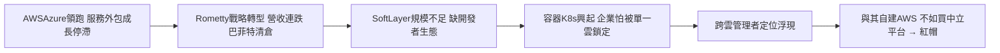

# 5.1 後 PC 時代的摸索（2011-2018）

2010 年代，雲端革命由 Amazon AWS（2006）、微軟 Azure 領跑，IBM 卻困在上一代成功裡：服務合約雖穩，但屬人力密集的外包，成長停滯；華生醫療商業化不如預期；2010 年代中期營收連續二十餘季下滑，巴菲特入股又清倉成為華爾街看衰的象徵。IBM 並非沒有雲（SoftLayer 2013 年被收購），缺的是開發者生態與公有雲規模——企業信任彌補不了 $價格 \times 敏捷$ 的差距。

執行長羅睿蘭（Ginni Rometty）提出「戰略轉型」（Strategic Imperatives）：雲端、數據、AI、社交、行動，口號正確卻成效分散。IBM 砍掉低毛利業務、分拆轉型，但每砍一刀營收就少一塊，新業務成長補不上舊業務流失，陷入「轉型＝衰退」的觀感。同時，開源與容器技術（Docker、Kubernetes）興起，企業不再想被單一雲鎖定——這反而給了 IBM 一個絕佳的切入點：不做最大的公有雲，做「跨雲的管理者」。

這個判斷把 IBM 引向 2018 年的豪賭：與其自建一個贏不了的 AWS，不如買下混合雲世界中最有號召力的中立平台。這個人選就是紅帽（Red Hat）。

### 因果鏈

前因是第四章服務轉型的副作用：遠離消費者與開發者，使 IBM 在公有雲起跑點就落後；華生商業化的挫折更證明單靠 AI 故事撐不起成長。後果是 IBM 被迫承認「當老大無望」，轉而尋找「當樞紐」的位置——混合雲。這個自我定位的轉變，直接驅動了 2018-2019 年 IBM 史上最大收購案：340 億美元買下紅帽。
