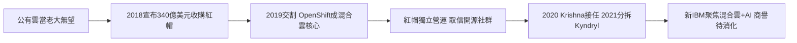

# 5.2 收購紅帽與混合雲戰略（2018-2020）

2018 年 10 月，IBM 宣布以約 340 億美元收購開源軟體巨頭紅帽（Red Hat），2019 年 7 月完成交割——IBM 百年史上最大收購，也是當時全球最大軟體收購之一。紅帽的 OpenShift（基於 Kubernetes 的容器平台）加上 IBM 的企業銷售與服務，被定位為「第一混合雲平台」：客戶可在自家機房、AWS、Azure 之間自由搬移工作負載，IBM 則收取平台與整合費用。

為取信開源社群，IBM 承諾紅帽獨立營運，保留品牌、總部與 CEO；2020 年阿爾文德·克里希納（Arvind Krishna，紅帽交易主導者）接任執行長，更加碼押注：2021 年把傳統基礎設施服務分拆為 Kyndryl，讓「新 IBM」聚焦混合雲與 AI。財務上紅帽維持雙位數成長，成為 IBM 轉型故事中唯一亮眼的引擎。

戰略邏輯是對 1981 年 PC 錯誤的 mirror 修正：當年把平台控制權讓給微軟與 Intel，這次花大錢把平台（OpenShift）買回來。但挑戰依舊：OpenShift 面臨原生雲服務的激烈競爭，340 億美元的商譽需要多年消化。紅帽賭的是企業級客戶對「不上鎖」的需求足夠大、大到養活一個獨立中立層——這正是 IBM 從打孔卡、360 以來最擅長收稅的位置。

### 因果鏈

被前因驅動：後 PC 時代的連續衰退與容器技術的興起，共同把 IBM 推向「買平台而非建雲」的結論；沒有 SoftLayer 的失敗與華生的挫折，董事會批不出 340 億美元。引發的後果是 IBM 第二次重生為平台公司——從賣機器，到賣服務，再到賣跨雲的中立層。而要讓這個故事在 2020 年代後半可信，IBM 還需要一張更前沿的技術牌：量子運算。
