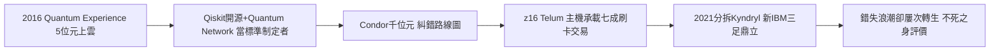

# 5.3 量子運算與主機延續（2016-2026）

2016 年，IBM 推出 IBM Quantum Experience，讓公眾透過雲端操作 5 位元超導量子處理器；2019 年發表 53 位元量子電腦並宣稱達成「量子優越性」路線圖競爭，2023 年推出 1,121 位元的 Condor 處理器，路線圖轉向模組化耦合與糾錯。IBM 採取與 PC 時代相反的策略：開放 Quantum Network 生態、公開路線圖、押注開源 Qiskit 工具鏈——要當量子時代的「相容標準制定者」，而非被掏空的組裝廠。

與此同時，最被看衰的大型主機卻從未死去：z 系列（System z）歷經 z13、z14、z15 到 2022 年 z16（內建 AI 加速晶片 Telum），仍承載全球約七成信用卡交易與大量銀行核心帳務。主機的年更新節奏證明了 1964 年相容架構的遠見：$相容_{半世紀} + 可靠_{不停機} = 護城河$。2021 年分拆 Kyndryl 後，主機、紅帽與諮詢構成「新 IBM」三足。

百年評價於是定格為一個悖論：IBM 屢次錯失自己參與開創的浪潮（小型機、PC、公有雲），卻屢次靠轉型活下來——從卡片到主機，從主機到服務，從服務到混合雲與量子。它的天才不在預見未來，而在瀕死時承認錯誤、變賣過去、買下未來。藍色巨人不再是帝王，而是企業世界的「不死之身」：不性感，但很難被替代。

### 因果鏈

前因貫穿全書：量子開放生態正是對 1981 年開放失控的修正——這次 IBM 手握 Qiskit 與硬體路線圖，不再簽非獨家賣身契；主機延續則是 1964 年相容決策的長期複利。後果是 IBM 在 2020 年代同時站在最老（主機）與最新（量子）的兩端：前者提供現金流，後者提供敘事權。從霍勒瑞斯的卡片孔洞到量子位元，IBM 的歷史證明了一件事：控制介面者控制利潤，而承認錯誤者才能活到下一個介面。
