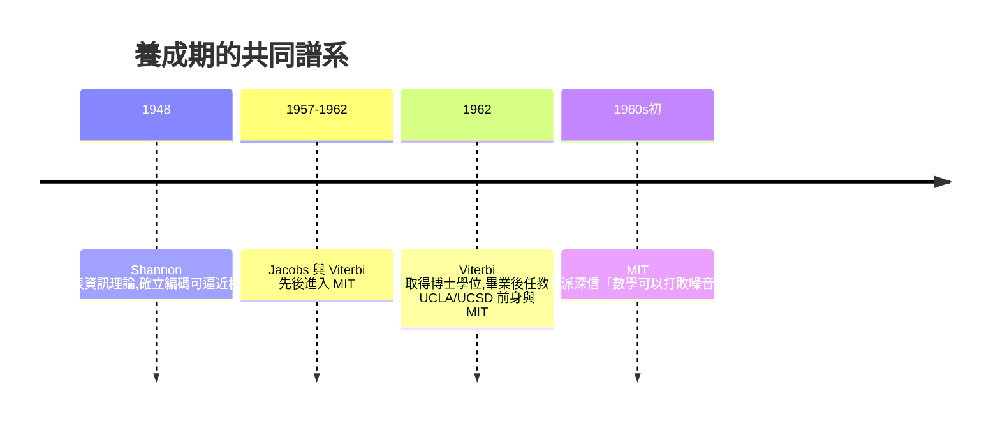

# 1.1 兩位麻省理工學人：Jacobs 與 Viterbi 的養成（1933-1962）

## 兩種出身，一條道路

Irwin Mark Jacobs 於 1933 年出生於麻州 New Bedford 的猶太移民家庭，父親經營餐廳。他自述小時候有閱讀障礙，卻在理工科目上展現天賦，最終進入 Cornell 大學電機系，再到 MIT 攻讀博士。Andrew James Viterbi 於 1935 年出生於義大利貝加莫的猶太家庭，因墨索里尼的種族法而於 1939 年隨家人移民美國，在波士頓長大，靠獎學金進入 MIT。兩人都曾是「外來者」——移民之子、靠學術翻身的世代——這種背景孕育了他們日後敢於離開體制、自創公司的性格。

## MIT 的資訊理論學派

兩人先後進入 MIT，都受到信息論創始人 Claude Shannon 與其學派（Robert Fano、Peter Elias 等）的影響。當時 MIT 的核心信念是：**通訊是數學問題**——只要用編碼與統計方法，就能在噪音中逼近 Shannon 極限地可靠傳輸。Jacobs 的博士研究在 Fano 指導下探討機率性編碼與偵測理論；Viterbi 則在 1962 年取得博士學位，研究方向是數位通訊與同步。這套「以數學駕馭噪音」的思維，正是日後 Viterbi 演算法與 CDMA 的種子。

## 學術與工業的邊界

1960 年代，數位通訊理論已經成熟，但工業界用的仍是類比系統；國防單位（如 JPL、航太廠商）是唯一願意為先進編碼理論付錢的客戶。Jacobs 曾在雷神公司（Raytheon）等處兼任顧問，深知理論與硬體之間存在巨大鴻溝，也深知「鴻溝即商機」。Viterbi 則先到噴推實驗室（JPL）任教職前的接觸，對衛星通訊的實務限制有親身體會。

## 因果鏈

**移民與戰亂 → 兩人靠理工教育翻身 → MIT 資訊理論學派洗禮 → 「數學可打敗噪音」的信念 → 理論成熟但工業界尚未採用 → 國防客戶是唯一買家 → 為「理論公司」創業埋下伏筆。**
