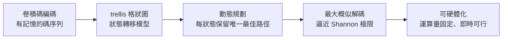

# 1.2 Viterbi 演算法的誕生（1966-1967）

## 問題：如何解出卷積碼？

當時最先進的錯誤更正碼是 **卷積碼（convolutional code）**：編碼器用移位暫存器把每個位元與前面若干位元混合，產生帶有記憶的碼序列。它編碼容易，但解碼是惡夢——接收端要在指數成長的序列空間中猜出最可能的原始訊息。序列式解碼（sequential decoding, Fano 演算法）雖可行，但運算時間不可預測，在實務硬體上難以承受。

## 演算法本身

Viterbi 在 1966-1967 年間想出了一個看似「笨」卻徹底的辦法：把卷積碼的編碼過程畫成一個**狀態格狀圖（trellis）**，然後用動態規劃，在每個時間步保留每個狀態的**唯一最佳路徑**。對卷積碼而言，這樣得到的正是**最大概似（maximum likelihood）解碼**——在數學上就是「最好的答案」。

路徑度量的核心遞迴可寫為：在時間 $t$、狀態 $s$ 的最佳路徑度量 $\Gamma_t(s)$ 滿足

$$
\Gamma_t(s) = \max_{s'} \left\{ \Gamma_{t-1}(s') + \lambda_t\big(x(s',s), y_t\big) \right\}
$$

其中 $s'$ 是前一狀態，$x(s',s)$ 是對應的分支碼字，$y_t$ 是接收訊號，$\lambda$ 是分支度量（例如 AWGN 通道下為平方距離 $-\|y_t-x\|^2$）。每一步只需比較 $2^k$ 條匯入路徑，計算量與狀態數成正比而非與時間長度成指數關係——這就是它得以硬體化的關鍵。

## Omura、Forney 與「被發現」的十年

有趣的是，Viterbi 本人最初以為這只是個有趣的教學性結果。是同門的 G. David Forney Jr. 在 1970 年代初指出：這不僅是演算法，更是**最大概似解碼器**，性能比序列解碼更穩定可預測。經過近十年，JPL 與軍方開始把 Viterbi 解碼器做成硬體，用於衛星與深空通訊；1980 年代起它進入每一片數據機、每一顆手機基頻晶片。Forney 的「重新詮釋」是理論變商品的關鍵一跳。

## 因果鏈

**卷積碼編碼容易、解碼極難 → Viterbi 用動態規劃在 trellis 上找最大概似路徑 → 起初被低估 → Forney 指出其最大概似本質 → 積體電路成熟使其可硬體化 → 成為衛星、數據機、手機的標配 → 「演算法在手，等一個硬體時代」——這正是創業的時機。**
