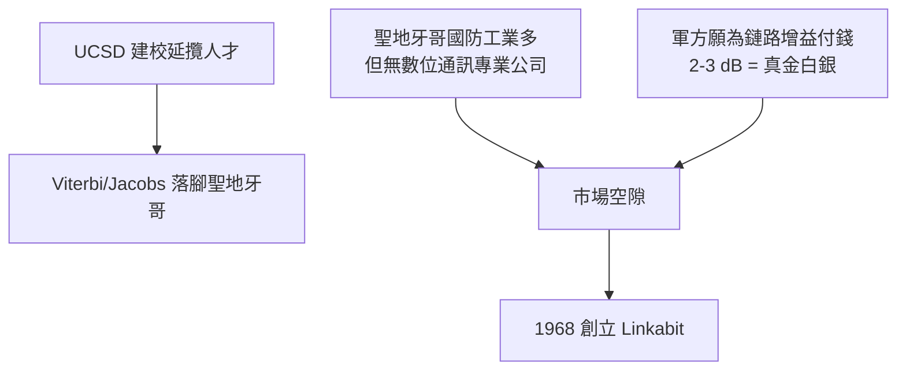

# 1.3 離開學術界：創業的抉擇（1967-1968）

## 聖地牙哥的機緣

1965 年，UCSD 剛創立，正在延攬理工師資；Viterbi 應邀南下成為 UCSD 電腦科學系的創系教授之一，Jacobs 也在此前後離開 Cornell/Cornell Aeronautical Lab 的軌道。兩人在聖地牙哥重逢，同時發現：聖地牙哥有大量國防與航太工業（General Dynamics、海軍基地、航太電子廠），卻幾乎沒有「把先進數位通訊理論做成設備」的公司。

## 教授為何下海

純粹的學術路徑無法把 Viterbi 演算法變成產品：大學沒有工程團隊與量產能力；大廠（如當時的通訊設備商）則認為編碼理論「太學術」。兩人判斷：**軍方與航太客戶願意為更好的鏈路預算付錢**——在衛星通訊上，若 Viterbi 解碼能省下 2-3 dB 的鏈路增益，等於天線更小、功率更低、或傳輸更遠，這對國防客戶是真金白銀的價值。

1968 年，兩人與康乃爾舊識 Klein Gilhousen 一起創立 **Linkabit**——名字意指「link（鏈路）+ a bit（位元）」：把每一個位元的鏈路做到極致。初始資本極少，公司在聖地牙哥的小辦公室起步，本質上是一家「顧問加上少量硬體」的理論公司。

## 因果鏈

**UCSD 建校 → 兩位 MIT 學人南遷 → 發現「軍事通訊需求多、數位通訊公司少」的市場空隙 → 軍方對鏈路增益有剛性需求 → Viterbi 演算法正是增益來源 → 學術無法落地、大廠不願冒險 → 1968 年自立門戶創立 Linkabit。**
