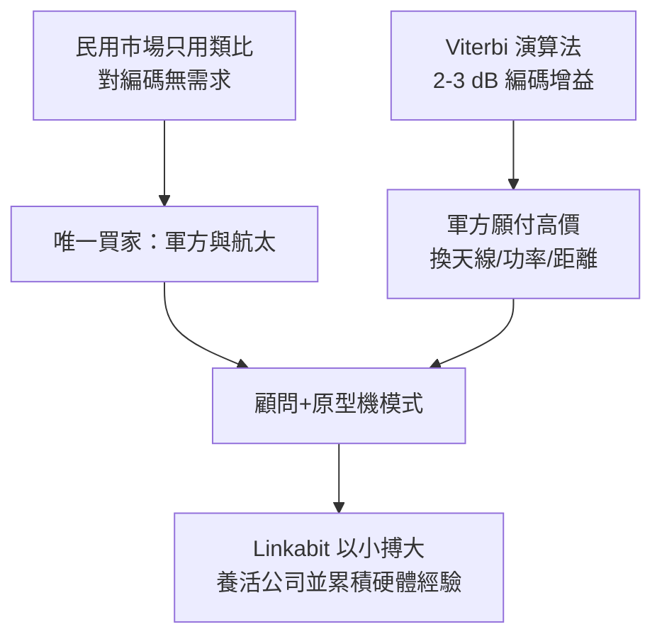

# 2.1 草創歲月：軍事合約養活的公司（1968-1973）

## 顧問公司起家

1968 年，Irwin Jacobs、Andrew Viterbi 與 Klein Gilhousen 在聖地牙哥創立 Linkabit 時，既無工廠也無雄厚資本，只有一個優勢：全美國最懂數位編碼與衛星鏈路的一批腦袋。公司最初的商業模式是「顧問＋原型機」——替軍方與航太單位解決別人解不開的通訊難題，再把研究成果做成小批量的專用設備。

這種模式在當時是必然選擇。民用通訊市場仍是 AT&T 的類比電話天下，對卷積碼、同步、展頻毫無興趣；唯有國防單位願意為「在強噪聲下多傳一個位元」付錢。Linkabit 的第一批合約多來自國防部、空軍與海軍的通訊研究計畫，題目正是兩位創辦人的老本行：編碼、調變、同步與抗干擾。

## 理論即產品

Linkabit 的工程師把 Viterbi 演算法從論文變成電路。當時積體電路剛起步，一個 Viterbi 解碼器要用數十片 TTL 晶片搭成機櫃大小的設備，昂貴但軍方買得起。關鍵的價值公式很直接：編碼增益（coding gain）

$$
G_c = \left(\frac{E_b}{N_0}\right)_{\text{uncoded}} - \left(\frac{E_b}{N_0}\right)_{\text{coded}} \quad \text{(dB)}
$$

在相同誤碼率下，省下的 $G_c \approx 2 \sim 3\,\text{dB}$ 可以直接換算成天線縮小、發射功率降低或傳輸距離拉長。對衛星與戰術電台而言，這就是戰力。

Linkabit 的作風也與眾不同：創辦人親自帶案子、親自寫報告，延攬的都是 UCSD 與 UCLA 的博士級人才。小公司、扁平組織、高濃度的數學能力，使它能以十數人的規模與大廠的實驗室競爭。

## 生存的邏輯

1968 至 1973 年間，Linkabit 沒有爆發性成長，但活下來了，而且活得很有名聲。它在國防通訊圈建立起「那家最懂編碼的小公司」的招牌。每一紙合約都同時是營收與研發：軍方出錢，讓 Linkabit 把理論磨成可用的硬體。

## 因果鏈

**民用市場無需求 → 軍方是唯一買家 → 顧問加原型機模式 → 編碼增益換算成軍事價值 → 小而精的博士團隊得以生存 → 每一份合約都是研發 → 為衛星設備商業化累積本錢。**
