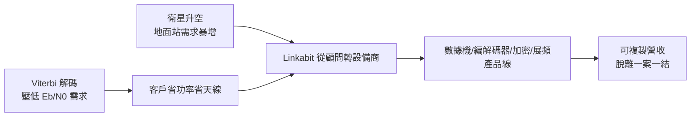

# 2.2 衛星通訊與編碼設備的商業化（1973-1978）

## 從顧問到設備商

1970 年代中期，衛星通訊進入實用化：DSCS 軍事衛星系統、商用同步衛星相繼升空，地面站與數據鏈的需求暴增。Linkabit 抓住這個轉折，把「接案研究」轉為「賣設備」——推出一系列搭載卷積編碼與 Viterbi 解碼的數據機（modem）與編解碼器產品。

技術原理上，這是把鏈路預算公式做到底。接收端的載噪比要求為

$$
\frac{C}{N_0} = \frac{E_b}{N_0} \cdot R_b
$$

其中 $R_b$ 為位元速率。Viterbi 解碼把所需的 $E_b/N_0$ 壓低數個 dB，整條衛星鏈路的功率與頻寬餘裕立刻放寬。對客戶而言，Linkabit 的盒子不是學術玩具，而是直接省錢省功率的設備。

## 視頻與加密的延伸

Linkabit 不只做編碼。它把數位訊號處理的專長延伸到視訊壓縮、加密通訊與展頻（spread spectrum）抗干擾設備。越戰後美軍對保密與抗干擾通訊的需求有增無減，Linkabit 的展頻與跳頻技術正中需求。公司營收開始擺脫「一案一結」的顧問循環，走向可複製的產品線。

同時，公司的工程文化成形：重數學、重實測、輕官僚。Jacobs 以嚴謹著稱，Viterbi 以直覺與速度著稱，Gilhousen 則是把理論變成可出貨硬體的關鍵人物。三人分工使 Linkabit 兼具論文能力與工廠能力。

## 商業化的意義

到 1978 年，Linkabit 已是國防數位通訊設備的重要供應商。更重要的是，它證明了一件事：**編碼理論可以是一門生意**。這個證明，是日後 Qualcomm 敢於押注 CDMA 的心理基礎——因為 Linkabit 人早就賣過「數學盒子」，知道客戶會為 dB 付錢。

## 因果鏈

**衛星實用化 → 地面設備需求暴增 → Linkabit 由顧問轉賣設備 → 編碼增益直接換算成客戶節省的功率與成本 → 產品線可複製 → 證明理論可以是生意 → 為更大規模擴張與日後 CDMA 賭注建立信心。**
