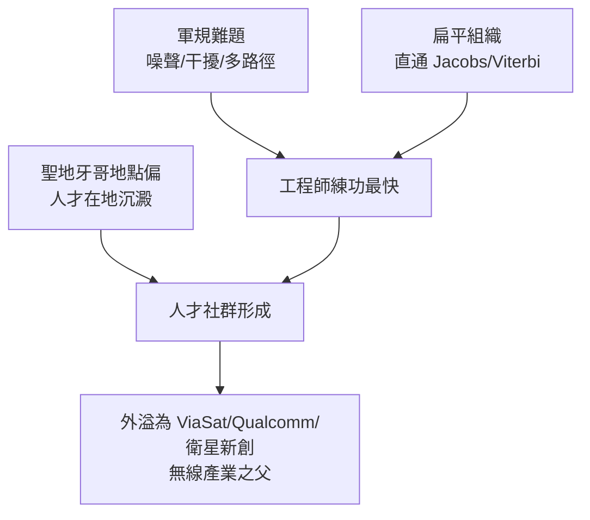

# 2.3 Linkabit 的擴張與人才搖籃（1978-1980）

## 聖地牙哥的磁石

1978 至 1980 年是 Linkabit 成長最快的兩年。員工人數從百人級向近千人攀升，聖地牙哥總部不斷擴編，還在東岸設立據點以貼近華府的軍方客戶。產品橫跨衛星數據機、戰術通訊終端、加密設備與網路處理器，儼然是一家中小型國防電子廠。

但 Linkabit 真正的資產不是廠房，而是人。它延攬與培養了一整代數位通訊工程師：許多 UCSD 的畢業生在 Linkabit 完成「理論到硬體」的成人禮，學會用示波器驗證數學。這些人日後散佈到聖地牙哥各處，創辦或加入 ViaSat、Qualcomm、眾多衛星新創——Linkabit 因此被稱為「聖地牙哥無線產業之父」。

## 為何成為搖籃

原因有三。第一，題目夠難：軍用規格逼著工程師處理最極端的噪聲、多路徑與干擾，練功速度最快。第二，組織夠扁：年輕工程師可以直接與 Jacobs、Viterbi 討論 trellis 與同步迴路，學術與實務零距離。第三，地點夠偏：聖地牙哥當時並非電子業中心，人才一旦落地就不易被矽谷挖走，形成在地社群。

用人才複利的觀點看，Linkabit 的產出函數是

$$
\text{產業影響} = (\text{員工人數}) \times (\text{題目難度}) \times (\text{留存率})
$$

三者皆高，遂產生超越公司本身的外部性。

## 盛極的隱憂

快速擴張也帶來管理負擔：產品線拉長、現金需求增加、對軍方單一市場的依賴加深。Linkabit 需要更大的資本與通路，這為 1980 年與 M/A-COM 的合併埋下伏筆——一間理論起家的公司，即將被推進大公司的懷抱。

## 因果鏈

**軍規難題加扁平組織 → 快速練兵 → 地點偏遠使人才沉澱 → 形成聖地牙哥通訊社群 → 公司盛極但管理與資金壓力上升 → 需要更大資本靠山 → 導向與 M/A-COM 合併。**
