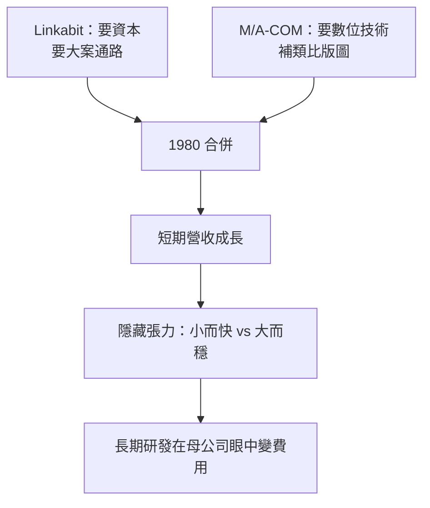

# 3.1 與 M/A-COM 的合併（1980）

## 各取所需

1980 年，Linkabit 與微波與國防電子大廠 M/A-COM 合併，Linkabit 成為其旗下子公司。從財務看，這是一樁各取所需的交易：Linkabit 需要資本擴充產能、拿下更大的國防系統標案；M/A-COM 則看上 Linkabit 的數位技術——當時微波與射頻仍以類比為主，數位編碼與訊號處理是面向未來的拼圖。

合併條件對創辦人頗為優厚，Jacobs 等人留任經營，短期內業務確實成長：背靠母公司的資金與通路，Linkabit 得以承接更大規模的衛星與軍事通訊計畫，員工人數與營收再創新高。表面上，這是理論公司與製造巨頭的完美互補：

$$
\text{綜效} = \text{Linkabit 數位技術} + \text{M/A-COM 微波硬體與通路} + \text{資本}
$$

## 互補的假象

但互補只是資產負債表上的算術。Linkabit 的核心競爭力並非廠房，而是「博士級小團隊快速把數學變成原型」的速度與自由；而 M/A-COM 是典型的東岸國防承包商：層級分明、流程嚴謹、重視季度財報。兩種組織邏輯從第一天就存在張力。

更深層的結構問題是：合併把 Linkabit 的命運與母公司的戰略綁在一起。當 M/A-COM 的重心轉向成本控制與既有產品線的利潤時，Linkabit 那些「高風險、高數學含量」的長期研發，就從資產變成了費用。

## 短暫的蜜月

合併後一兩年，蜜月尚存。Viterbi 演算法的硬體化隨 VLSI 進步而成本大降，Linkabit 的解碼器產品正好搭上順風車。但蜜月越甜，後來的文化衝突就越苦——因為雙方都證明了自己是對的，也就更不願改變。

## 因果鏈

**擴張需要資本 → M/A-COM 需要數位技術 → 1980 年合併各取所需 → 短期營收成長掩蓋組織邏輯差異 → 小而快的研發文化與大而穩的管控文化對撞 → 長期研發被視為費用 → 為文化衝突與出走埋下引線。**
