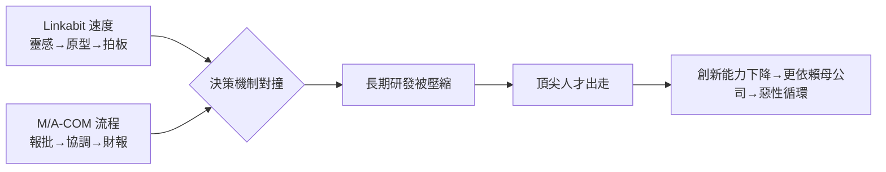

# 3.2 文化衝突與大公司病（1980-1985）

## 兩種時間尺度

在 Linkabit，時間以「靈感與原型」計：一個好的編碼方案，幾個人幾個月就能搭出可演示的硬體，創辦人拍板即可投入。但在 M/A-COM 體系下，時間以「預算週期與審批鏈」計：立項要層層報批，跨部門協調曠日持久，對短期回報的要求壓過對技術突破的耐心。

Jacobs 與 Viterbi 習慣的領導方式是「以技術說服人」——誰的數學對、誰的實測好，誰就做主。而大公司的邏輯是「以職位與流程管控風險」。當 Linkabit 想要投入那些當時看似冷僻的方向（如展頻、封包無線、未來的數位蜂窩）時，母公司看到的只是低毛利與不確定性。

## 人才的流失

文化衝突最先反映在人才上。Linkabit 原本吸引的是「想解難題」的工程師；一旦決策變慢、題目變保守，最優秀、最有創業精神的人便開始出走——許多人正是日後聖地牙哥無線圈的創業種子。諷刺的是，大公司的管控本意是降低風險，結果卻把最能創造未來的人才推了出去。

可以用一個簡單的不等式概括：當

$$
\text{官僚成本} > \text{大平台收益}
$$

時，頂尖人才與創辦人的理性選擇就是離開。1980 至 1985 年間，這個不等式在 Linkabit 內部逐漸成立。

## 歷史的似曾相識

這一幕在科技史上反覆上演：充滿活力的技術公司被收購後，因文化不合而失速。Linkabit 的特殊之處在於，它的創辦人同時是世界級的理論家——他們不需要大平台來證明自己，反而是大平台束縛了他們。當連創辦人都感到「待在這裡做不出下一個 Viterbi 演算法」時，離開只是時間問題。

## 因果鏈

**小而快對上大而穩 → 決策機制對撞 → 長期研發被壓縮 → 最有創業精神的人才先走 → 創新能力下降 → 母公司更加強管控 → 惡性循環 → 連創辦人都感到窒息 → 出走成為理性選擇。**
