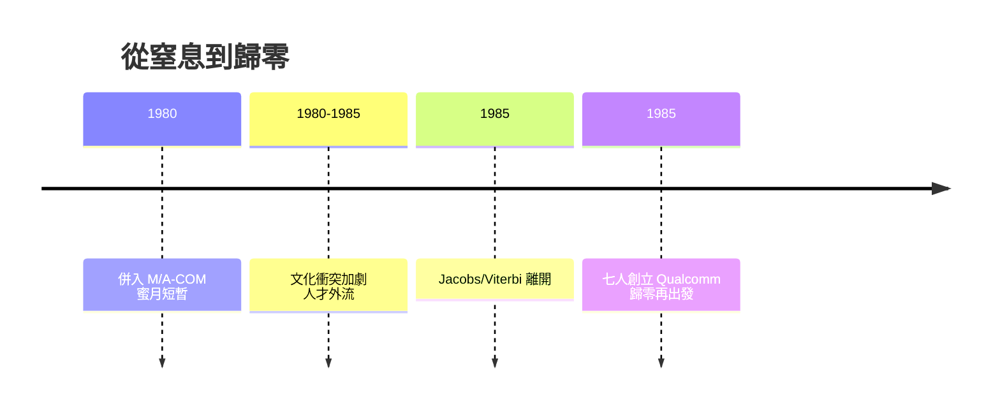

# 3.3 創辦人的抉擇：再度歸零（1985）

## 五十歲的再創業

1985 年，Jacobs 已 52 歲，Viterbi 50 歲。以常理看，他們大可留在 M/A-COM 體系內做高管，名利雙收。但兩人選擇了最難的路：離開舒適圈，再度白手起家，創立 Qualcomm（Quality Communications）。

這個抉擇有三重推力。第一是**技術直覺**：他們看到數位蜂窩與衛星定位的前夜，認定「無線數位通訊」即將爆發，大公司體制做不出來。第二是**創業記憶**：1968 年創立 Linkabit 的成功經驗告訴他們，小團隊可以戰勝大實驗室。第三是**人才牽引**：Linkabit 散出的老部下（如 Gilhousen 等人）願意追隨，形成現成的創業班底。

## Linkabit 模式的複製與升級

新公司 Quality Communications 的起點，幾乎是 Linkabit 1968 年的翻版：七位創始人、以合約研究養活自己、小而精的數學團隊。但目標更大——不再滿足於做軍方的供應商，而是要定義民用無線的標準本身。

離開的代價是真實的：放棄高薪職位、放棄 Linkabit 親手養大的團隊與產品線，從零開始找客戶。但收益也是歷史級的：正因為歸零，他們才得以押注所有大公司都不敢押的 CDMA。這一步，沒有 M/A-COM 五年的窒息感，恐怕走不出來。

## 分水嶺

1985 年因此成為聖地牙哥無線史的分水嶺：Linkabit 時代結束（它日後幾經轉手，品牌逐漸淡出），Qualcomm 時代開啟。前者證明了「數學可以賣給軍方」，後者將證明「數學可以賣給全世界每支手機」。

## 因果鏈

**大公司窒息感 → 創辦人認定無線數位浪潮將至 → Linkabit 創業記憶提供信心 → 老部下形成班底 → 1985 年歸零創立 Qualcomm → 目標從軍方供應商升級為民用標準制定者 → 為 CDMA 豪賭清出戰場。**
