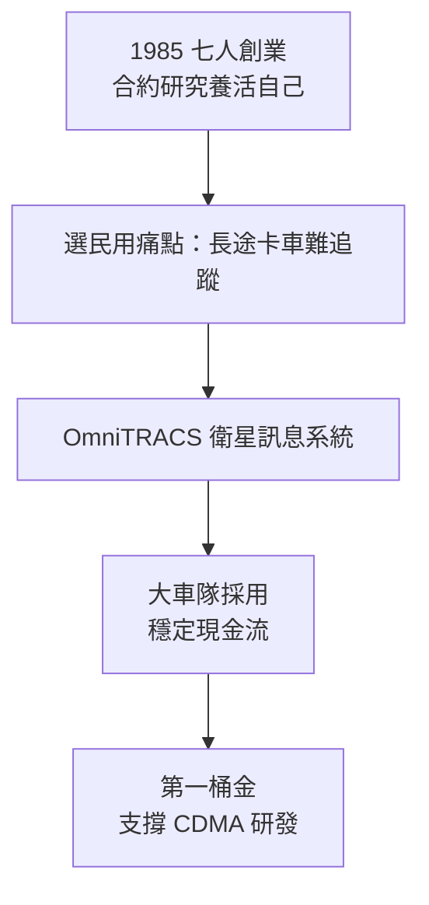

# 4.1 七人創業與 OmniTRACS（1985-1988）

## 先活下來，再談理想

1985 年 7 月，Jacobs、Viterbi、Gilhousen、Harvey White、Axelband、Wichman、Franklin Antonio 七人在聖地牙哥創立 Qualcomm。與 1968 年如出一轍，新公司先靠合約研究維持現金流；不同的是，這次他們把目光投向民用市場——長途卡車的衛星通訊與定位。

成果就是 **OmniTRACS**：一套 Ku 頻段衛星雙向訊息系統，讓貨運公司能即時追蹤全美卡車位置並收發短訊。技術上它並不炫目——窄頻、低速率、重在可靠的鏈路設計與網路管理——但商業上極其成功，成為 Qualcomm 第一桶金。Schneider 等大型車隊的採用，證明了「衛星＋車隊管理」模式的價值。

## 為何是卡車

選擇卡車市場是精準的務實主義。蜂窩電話當時尚在萌芽，標準未定、牌照昂貴；而長途貨運有明確痛點（找不到車、聯絡靠路邊電話），願意為衛星終端付錢。OmniTRACS 的成功公式是

$$
\text{現金流} = (\text{明確痛點}) \times (\text{付得起錢的客戶}) \times (\text{夠用就好的技術})
$$

它不賭未來，只解決現在——賺來的每一分錢，都成為日後 CDMA 豪賭的彈藥。

## 現金奶牛的戰略意義

OmniTRACS 常被 CDMA 的光芒掩蓋，但沒有它就沒有 Qualcomm。它讓公司在不依賴創投輸血的情況下養起數十人的 CDMA 團隊，也讓 Jacobs 在與電信巨頭談判時有底氣——「我們不是紙上談兵的教授，我們是有出貨產品的公司」。Linkabit 教會他們賣數學盒子給軍方；OmniTRACS 教會他們賣系統給民用客戶。

## 因果鏈

**歸零創業需現金 → 避開未定的蜂窩標準戰 → 切入卡車衛星痛點 → OmniTRACS 成功帶來現金流與商譽 → 養起 CDMA 團隊 → 為挑戰整個行動通訊正統提供彈藥與底氣。**
