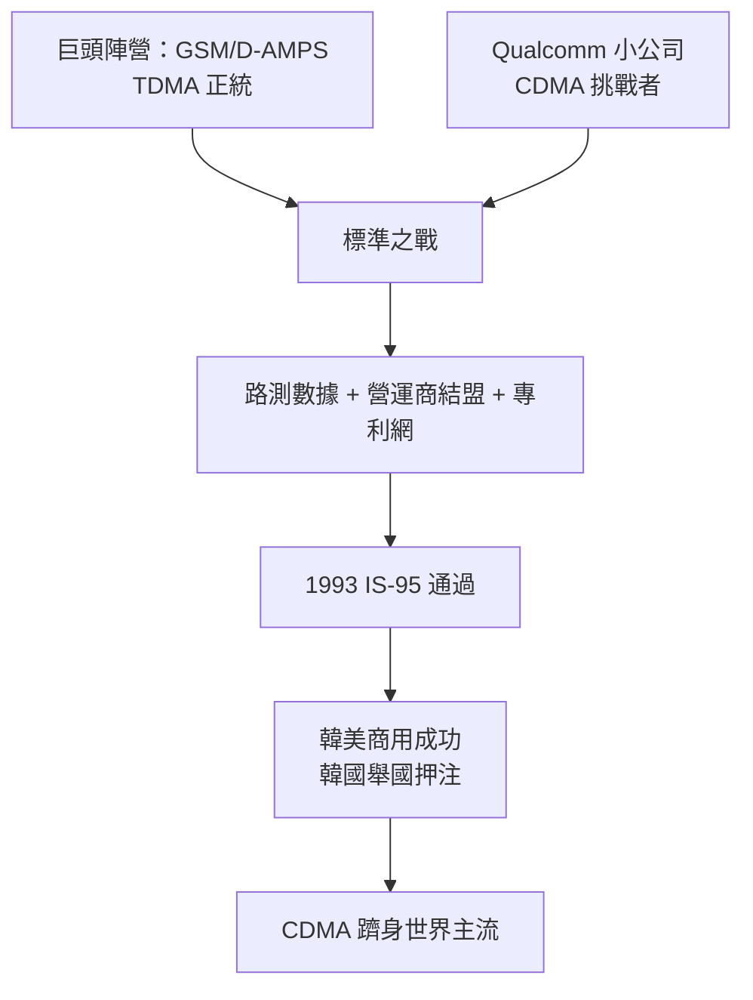

# 4.3 IS-95 標準之戰（1991-1995）

## 以小搏大的標準戰

1990 年代初，美國蜂窩標準組織（TIA）面臨抉擇：歐洲已團結在 GSM（TDMA）周圍，美國的 D-AMPS（TDMA）陣營由摩托羅拉、AT&T、愛立信等巨頭把持。Qualcomm 作為一家數百人的小公司，竟提案以 CDMA 作為第二代數位標準——對手是整個既有產業鏈。

標準之戰從來不只是技術比較，更是測試、遊說與商務承諾的總和。Qualcomm 的策略有三：第一，持續公開路測數據，用容量與話音品質說話；第二，結盟營運商（尤其是渴望差異化的新進業者如 Sprint、韓國電信），以商用承諾倒逼標準；第三，專利先行，把 CDMA 核心專利網織密，讓採用者必須與其合作。

## IS-95 的誕生

1993 年，TIA 通過 **IS-95（cdmaOne）** 作為北美雙模標準之一；1995 年香港、韓國相繼商用，1996 年美國 Sprint 大規模部署。實測證明 CDMA 的容量與覆蓋優勢真實存在，尤其在韓國——政府把 CDMA 定為國家標準，舉國投入，使韓國一躍成為 CDMA 王國，也反過來鞏固了 IS-95 的全球地位。

這一勝的數學底層，仍是 Linkabit 時代的老朋友：卷積碼加 Viterbi 解碼、功率控制環、擴頻增益。二十年前為衛星寫下的方程式，如今寫進了每一支手機的標準文件。

## 勝利的代價與果實

標準戰勝利後，Qualcomm 迅速轉型為「專利＋晶片」公司：賣 MSM 系列基頻晶片，同時按整機價格收取權利金。這套模式利潤驚人，也種下了日後與手機廠、與各國反壟斷機構纏鬥二十年的種子。但在 1995 年的當下，它意味著一件事：Linkabit 那間小小理論公司的衣缽，終於穿上了世界標準的外衣。

## 因果鏈

**TDMA 巨頭壟斷 → Qualcomm 以實測數據撕開缺口 → 結盟新進營運商與韓國 → IS-95 通過並商用成功 → 小公司改寫世界標準 → 專利加晶片模式確立 → 為 3G 專利帝國鋪路。**
