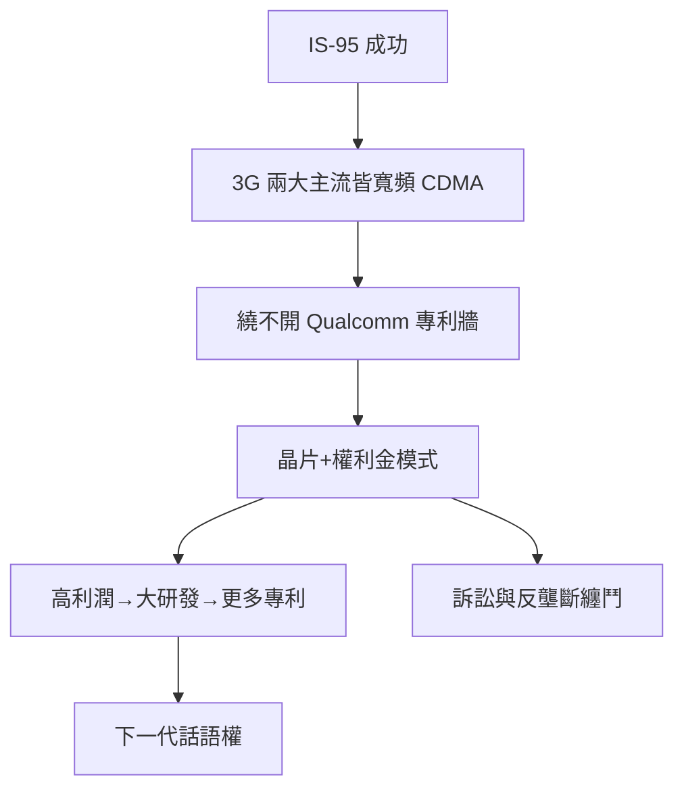

# 5.1 3G 晶片與權利金模式（1995-2005）

## CDMA2000 與 WCDMA：都繞不開 Qualcomm

IS-95 成功後，國際電信聯盟（ITU）啟動 3G（IMT-2000）標準化。歐洲 GSM 陣營本想以純 TDMA 演進擺脫 Qualcomm 專利，卻發現高速數據終究需要擴頻與碼域處理；最終兩大 3G 主流——美國主導的 **CDMA2000** 與歐洲主導的 **WCDMA**——底層都是寬頻 CDMA，誰也繞不開 Qualcomm 的專利牆。

Qualcomm 順勢把商業模式做到極致：**賣晶片（MSM 基頻＋射頻）＋收權利金（按整機批發價約數個百分點）**。手機賣得越多、越貴，Qualcomm 收得越多，而自身不承擔建廠與庫存的全部重負。1999 年出售手機終端與基地台業務、專注上游，更使毛利率扶搖直上。公司的獲利公式可寫為

$$
\text{利潤} = (\text{晶片毛利} \times \text{出貨量}) + (\text{權利金率} \times \text{全球 3G 手機銷售額})
$$

第二項幾乎是零邊際成本——這就是「專利帝國」的財務本質。

## 愛與恨

這套模式創造了空前的研發飛輪：權利金供養龐大的聖地牙哥研發團隊，研發產出更多專利，專利鞏固下一代標準話語權。但也招來持久的敵意：手機廠抱怨成本過高，諾基亞、博通乃至各國政府輪番發起訴訟與反壟斷調查。Qualcomm 在法庭與談判桌上的時間，幾乎不亞於在實驗室的時間。

然而公允地說，沒有 Qualcomm 在 1980 年代末的孤注一擲，3G 的高速數據能力至少晚到數年。專利費之爭，本質上是「先行者該分多少蛋糕」之爭。

## 帝國的頂峰

2000 年代初，Qualcomm 躋身全球無線晶片霸主，聖地牙哥總部園區迅速擴張。Linkabit 當年近千人的規模，如今變成上萬人；當年為軍方省 dB 的數學，如今為全球每一支 3G 手機計費。

## 因果鏈

**IS-95 證明 CDMA → 3G 兩大標準皆採寬頻 CDMA → Qualcomm 專利牆不可繞過 → 晶片加權利金模式 → 高利潤供養大研發 → 鞏固標準話語權 → 同時招來訴訟反壟斷 → 帝國頂峰與爭議並存。**
