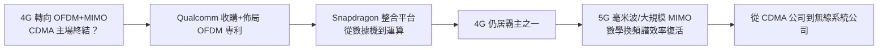

# 5.2 4G OFDM 的轉型與 5G 延續（2005-）

## 當世界轉向 OFDM

諷刺而關鍵的一幕發生在 4G：LTE 採用 **OFDM＋MIMO** 而非 CDMA，理論上是 Qualcomm 主場的終結。OFDM 把高速串流拆成多個正交窄頻子載波，以對抗多路徑衰落，其子載波正交條件為

$$
\Delta f \cdot T_s = 1, \quad s(t) = \sum_{k} X_k e^{j2\pi k \Delta f t}
$$

加上 Turbo 碼／LDPC 與 MIMO 空間多工，頻譜效率超越 3G CDMA。WiMAX 與 LTE 陣營一度想藉此擺脫 Qualcomm 的專利稅。

Qualcomm 的應對不是對抗物理，而是**用專利與收購追上物理**。它早已佈局 OFDM 相關專利，並以 2007 年收購 Flarion（OFDM 先驅）為代表，把 OFDMA 的核心能力納入囊中；同時以 Snapdragon 應用處理器加整合基頻的路線，把戰場從「數據機制式」轉向「整機運算平台」。4G 時代 Qualcomm 依然是最大基頻供應商之一，證明了它已從「CDMA 公司」轉型為「無線系統公司」。

## 5G：回到擴頻直覺的上層

5G（NR）延續 OFDM，加大頻寬、引入毫米波與大規模 MIMO，對同步、編碼與訊號處理的要求更高。Qualcomm 在毫米波射頻、LDPC／Polar 碼、低延遲設計上均居前列。耐人尋味的是，當年 CDMA 的核心直覺——**以複雜訊號處理換頻譜效率**——在 5G 以更高階的形式復活：大規模天線的波束成形，本質上仍是數學打敗噪聲。

同期 Viterbi 演算法雖在數據通道被 Turbo／LDPC 超越，仍廣泛用於控制通道、衛星、儲存與語音辨識（HMM 解碼），成為名副其實的「數位基石」。

## 轉型的啟示

Linkabit 賣的是盒子，2G Qualcomm 賣的是標準，4G/5G Qualcomm 賣的是平台。每一代底層波形都在變，不變的是同一條能力鏈：編碼、同步、射頻、系統整合——全都源自 MIT 與 Linkabit 的數學基因。

## 因果鏈

**4G 轉向 OFDM 威脅專利根基 → Qualcomm 以收購與專利佈局跟上 → 轉向 Snapdragon 整合平台 → 保住 4G 霸主地位 → 5G 以更高階訊號處理延續同一基因 → 從 CDMA 公司蛻變為無線系統公司。**
