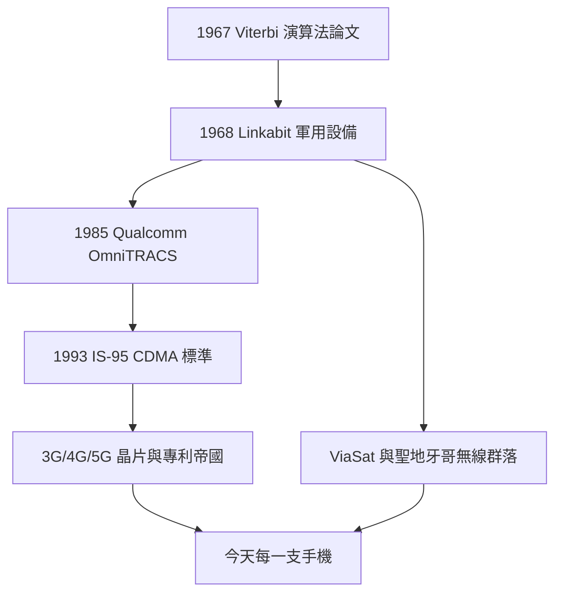

# 5.3 聖地牙哥之父：Linkabit 的遺產

## 一間公司，一座城市的產業

回望半世紀，Linkabit 最深遠的遺產不在任何單一產品，而在它創造的**人群與範式**。人群上，它直接孵化了 Qualcomm、ViaSat，並間接催生了聖地牙哥數百家通訊、衛星與半導體公司——「無線聖地牙哥」不是規劃出來的，是 Linkabit 校友創業網絡長出來的。範式上，它確立了「理論→原型→標準→晶片→專利」的產學研鏈路，後來者無不仿效。

Jacobs 與 Viterbi 個人亦成為傳奇：Jacobs 以慈善回饋聖地牙哥（UCSD 工學院以其命名），Viterbi 以演算法之名垂青史（Viterbi 演算法進入每一本通訊教科書）。兩位移民之子、MIT 教授，用一條演算法與兩間公司，改寫了人類口袋裡那塊玻璃的內涵。

## 從 Linkabit 到每一支手機

今天每一支手機的通話與上網，都疊著 Linkabit 的幽靈：Viterbi 解碼的思想活在基頻晶片裡，CDMA 的功率控制活在蜂窩協議裡，OmniTRACS 的衛星物聯直覺活在今天的衛星直連手機裡。就連 Qualcomm 的專利模式，也可視為 Linkabit「為 dB 付費」商業直覺的終極放大版——只不過買家從國防部變成了全世界。

## 蓋棺之論

Linkabit 只活了十二年獨立歲月（1968-1980），品牌早已淡出，但它的因果鏈從未中斷：**沒有 MIT 的資訊理論，就沒有 Viterbi 演算法；沒有軍方合約，就沒有 Linkabit；沒有 M/A-COM 的窒息，就沒有 Qualcomm；沒有 OmniTRACS 的現金，就沒有 CDMA 豪賭；沒有 IS-95 的險勝，就沒有 3G/4G/5G 的專利帝國。** 一環扣一環，恰是本傳記每節「因果鏈」想要說明的全部。

## 因果鏈

**演算法論文 → 軍用設備 → 人才群落 → 出走再創業 → 民用標準 → 晶片專利帝國 → 聖地牙哥無線之都與現代手機 → 總因果：一條數學思想長成一個產業，而 Linkabit 正是那粒種子落土之處。**
