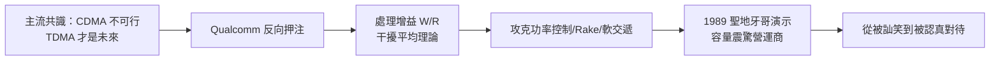

# 4.2 CDMA 的理論與演示（1988-1991）

## 人人說不行的技術

1980 年代末，行動通訊的主流共識是：分頻（FDMA，類比 AMPS）正被分時（TDMA，數位 GSM、D-AMPS）取代，而**分碼多工（CDMA）**只是軍用展頻的變體，容量有限、功率控制太難、商用不可行。當 Qualcomm 宣稱要用 CDMA 做蜂窩系統時，整個業界的反應是訕笑。

但 Jacobs 與 Viterbi 的數學直覺恰恰相反。CDMA 讓所有用戶共用同一頻段，以正交（或準正交）擴頻碼區分；其處理增益為

$$
G_p = \frac{W}{R} = \frac{\text{擴頻頻寬}}{\text{資訊速率}}
$$

例如 $W = 1.25\,\text{MHz}$ 、 $R = 9.6\,\text{kbps}$ 時， $G_p \approx 21\,\text{dB}$ 。這 21 dB 的增益，加上語音激活（DTX）、扇區化、功率控制與軟交遞（soft handoff），理論上可使系統容量數倍於 TDMA。關鍵洞見是：**蜂窩容量的瓶頸不是正交分割，而是干擾平均**——而 CDMA 正是最擅長平均干擾的體制。

## 從白皮書到路測

Qualcomm 把理論變成演示。1988 至 1991 年間，團隊解決了 CDMA 蜂窩化的三大工程難題：快速精確的功率控制（解決遠近效應）、Rake 接收機對抗多路徑、軟交遞提升邊緣覆蓋。1989 年在聖地牙哥的現場演示中，CDMA 原型系統在同一頻段內容納的通話數令觀摩的營運商震驚。

這正是 Linkabit 模式的民用翻版：先有數學，再有原型，最後用實測讓懷疑者閉嘴。Viterbi 演算法也在其中——CDMA 的卷積編碼加 Viterbi 解碼提供了關鍵的編碼增益，創辦人二十年前的論文，此刻正在自己的系統中運轉。

## 賭注的本質

CDMA 演示的成功，把 Qualcomm 從「卡車衛星公司」變成「要改寫蜂窩標準的公司」。風險也隨之飆升：接下來要面對的不是技術問題，而是標準、專利與電信政治的戰爭。

## 因果鏈

**業界迷信 TDMA → Qualcomm 以干擾平均理論反向押注 CDMA → OmniTRACS 現金流支撐研發 → 攻克功率控制與軟交遞 → 實地演示證明容量 → 懷疑轉為重視 → 把戰場從實驗室推向標準組織。**
