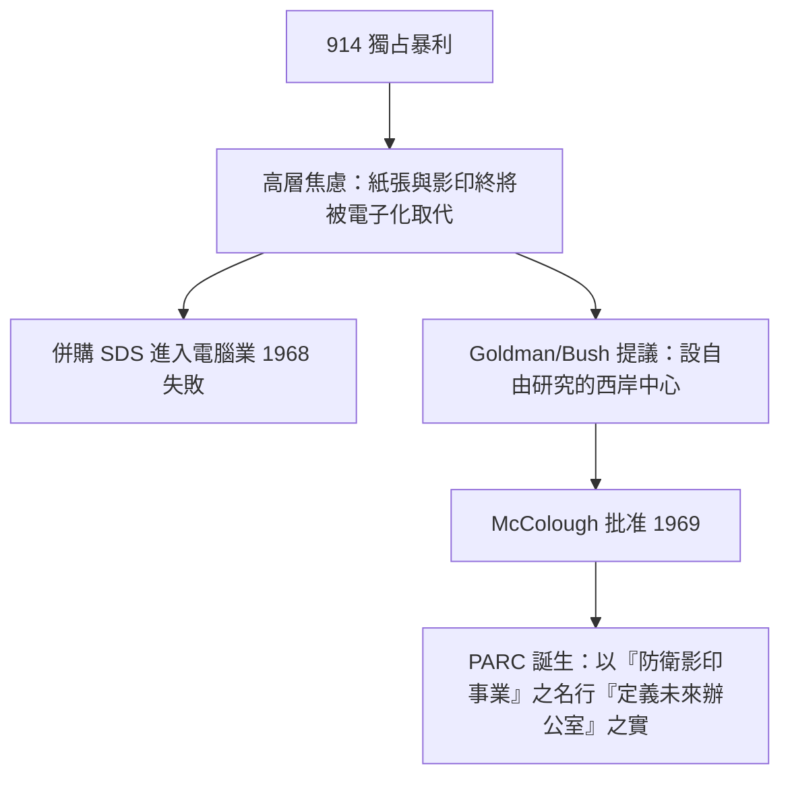

# 1.2 獨占利潤與研究中心的規劃（1959-1969）

Xerox 914 的暴利帶來一個高層普遍的焦慮：**影印技術總有一天會被取代，辦公室的「紙」本身就是目標**。執行長 Joseph Wilson 與總裁 Peter McColough 意識到，公司未來的威脅不是更好的影印機，而是「無紙辦公室」——而那正是電腦的領域。

Xerox 先在 1968 年併購 Scientific Data Systems（SDS），跨入大型電腦業務（後來證明失敗），顯示高層想「買」進運算未來。與此同時，公司內部出現了由 Jacob Goldman（Jacobson，電腦科學博士出身的實驗室主管）與物理學家 John Powers Bush 主導的構想：與其在東岸總部旁設一個服務現有產品的實驗室，不如在距離羅徹斯特三千公里外的西岸，建一個**不受產品部門干擾、自由探索「未來辦公室」**的中心。

Goldman 的論證直接命中公司命脈：Xerox 的對手將是 IBM 與電腦公司，而非同業影印商；若不研究資訊如何以電子方式產生與傳遞，公司將在自己的核心市場被殲滅。這份以「防衛核心事業」包裝的前瞻提案，說服了董事會。1969 年，McColough 批准在加州帕洛阿圖、史丹佛大學旁設立 **Palo Alto Research Center**。

### 因果鏈
獨占利潤 → 對「電子化取代紙」的生存焦慮 → SDS 併購失敗證明「買技術」行不通 → Goldman 與 Bush 改推「自建遠期研究中心」的論述 → 董事會以自我防衛為由批准 PARC。PARC 的成立動機是防衛，但執行的結果卻是革命——這個矛盾貫穿了它整個歷史。
