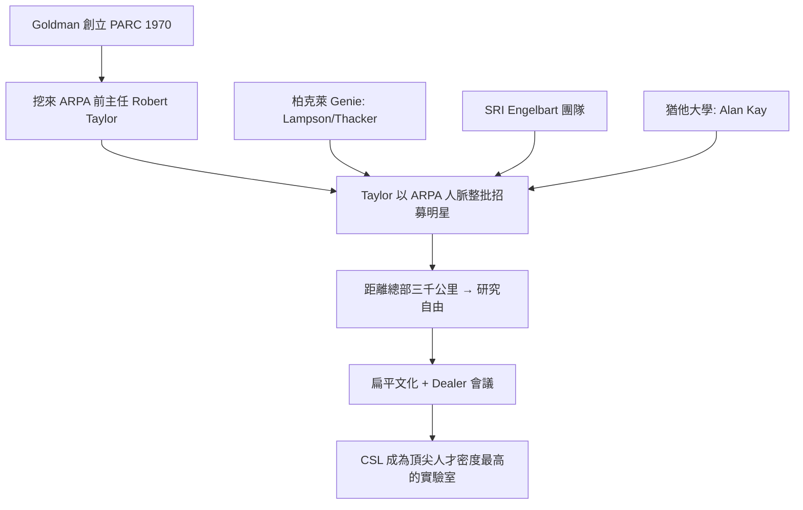

# 1.3 Taylor 接手與帕洛阿圖選址（1969-1970）

PARC 首任總經理是 Goldman 本人，但他隨即面臨招募難題：頂尖的電腦科學家為什麼要到一家影印機公司工作？Goldman 從國防部高等研究計劃署（ARPA）挖來了 **Robert Taylor**——ARPA 資訊處理技術辦公室（IPTO）的前主任，阿帕網（ARPANET）的催生者。Taylor 在 ARPA 資助過全國最好的電腦科學實驗室，深知人才與研究品味的重要，1970 年他正式接掌 PARC 的電腦科學實驗室（CSL），並請來柏克萊的 Bertram Raphael 等人共同組建團隊。

Taylor 的招募策略堪稱教科書：目標是 **ARPA 網絡中的明星研究者**。他先後從史丹佛研究院（SRI，Engelbart 的 Augmentation Research Center）、加州大學柏克萊分校（Project Genie，Butler Lampson、Chuck Thacker、Peter Deutsch 等人，該團隊因經費問題解散）、猶他大學（Alan Kay 等）、華盛頓大學等處整批挖角。至 1971 年底，PARC 已聚集約二十位當代最頂尖的電腦科學家。

選址帕洛阿圖不是偶然：緊鄰史丹佛大學，方便借重學術社群與招募人才；同時三千公里的距離讓研究者**物理上隔絕於羅徹斯特總部的日常干預**。Taylor 親手創造了一種前所未有的研究文化——扁平組織、每週一次的「Dealer」全員會議、任何決定當眾辯論、研究員只對「做出最好的東西」負責。這個文化是 PARC 十年爆發性創造力的引擎，但也埋下了與總部互不理解的地雷。

### 因果鏈
914 利潤養出 PARC → PARC 的合法性繫於能否吸引一流人才 → Taylor 用 ARPA 的信譽與人脈一次解決招募問題 → 柏克萊 Genie 團隊因經費解散而「整批」到位 → 這批人後來設計了 MAXC、Alto 與乙太網路。選址西岸的隔離換來創造自由，也換來了總部的疏離——兩者將在第 4 章一起引爆。
