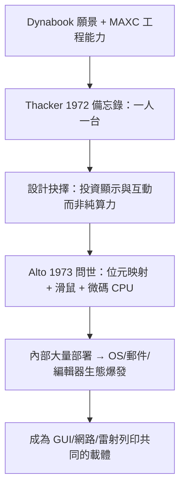

# 2.2 Alto：第一部真正的個人電腦（1972-1973）

1972 年，Chuck Thacker 在一頁備忘錄上寫下 Alto 的規格：夠小，能放進辦公室；夠便宜，能一人一台；夠快，能即時顯示圖形。這在當時是異端——主流仍是大型主機加終端機的分時系統，而 Thacker 與 Butler Lampson 卻主張把整部電腦交到個人手上。MAXC 練出的微碼（microcode）設計能力與 MOS 記憶體經驗，讓這個狂想有了工程基礎。

Alto 的硬體在今日看來簡陋，在當時卻是豪華：606×808 單色位元映射螢幕、直立如紙張的顯示方向、可程式微碼處理器、2.5 MB 可換式硬碟、以及三鍵滑鼠。關鍵抉擇是**把一半以上的系統成本花在顯示與互動上**，而非運算速度。Lampson 的名言是：「我們不是在造更快的計算器，而是在造新的通訊媒介。」1973 年 4 月，第一批 Alto 開機；到 1975 年約生產了 150 台，1979 年更推出 Alto II，PARC 內部人手一台。

Alto 從不是商品，而是「活的實驗平台」。作業系統 Alto OS、檔案系統、電子郵件（Laurel）、文字編輯器（Bravo，所見即所得的前身）全都跑在同一台機器上。由於摩爾定律不斷壓低成本，PARC 敢於假設 $C(t) = C_0 \cdot 2^{-t/2}$ 的價格曲線會讓 Alto 從數萬美元降到千美元級——Dynabook 只是時間問題。這種「為五年後的硬體寫今天的軟體」的策略，是 PARC 超前業界十年的秘密。

### 因果鏈
MAXC 證明自製能力 → Thacker 敢提一人一台 → 顯示優先的取捨造就位元映射架構 → Alto 作為平台養出上層軟體 → Alto 反過來成為乙太網路、GUI、雷射印表機必須存在的理由。沒有 Alto，後面三項發明都將是無根之木。
