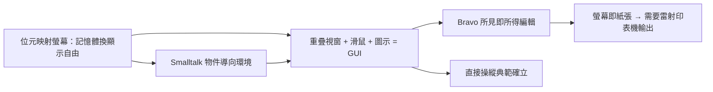

# 2.3 位元映射螢幕、GUI 與 Smalltalk（1973-1975）

位元映射（bitmapped display）是 Alto 一切魔法的起點：螢幕上每個像素對應記憶體中的一個位元，軟體可以任意點亮。這與字元終端機有本質差別——後者只能顯示固定字形，前者能顯示**任何圖形、字體與版面**。代價是記憶體：$606 \times 808 \approx 489{,}648$ 位元，約 60 KB，在 1973 年相當奢侈。PARC 押注記憶體價格會依摩爾定律下跌，這個賭注贏了。

在此之上，Alan Kay 的 Learning Research Group 用 Smalltalk 語言探索「物件導向」：一切皆物件，物件之間傳遞訊息。Dan Ingalls 實作的 Smalltalk-72/76 與重疊視窗系統，加上 Doug Engelbart（SRI）滑鼠概念的改良，催生了現代 GUI 的三件套——**視窗（windows）、圖示（icons）、滑鼠指向（pointing）**，以及下拉式選單、對話框。Bravo（Charles Simonyi 主持）則是第一套所見即所得（WYSIWYG）編輯器：在螢幕上看到的粗體、字體與版面，就是雷射印表機印出的樣子。

這三者的結合是革命性的：Smalltalk 讓程式設計變成「組合物件」，GUI 讓操作變成「直接操縱」，Bravo 讓文件變成「螢幕即紙張」。1975 年的 Alto 用戶已在用滑鼠拖曳視窗、用 Bravo 排版、用 Smalltalk 寫動畫——而外界的個人電腦（Altair 8800 剛問世）還在用開關與紙帶。PARC 把未來提前了十年。

### 因果鏈
摩爾定律使位元映射可行 → 任意圖形能力誘發 GUI 想像 → Smalltalk 提供物件模型支撐視窗系統 → Bravo 把螢幕與紙張縫合 → 「螢幕即紙張」反過來驅動雷射印表機成為必需品。顯示、介面與列印三者互相拉扯，形成第 3 章的完整辦公室圖景。
