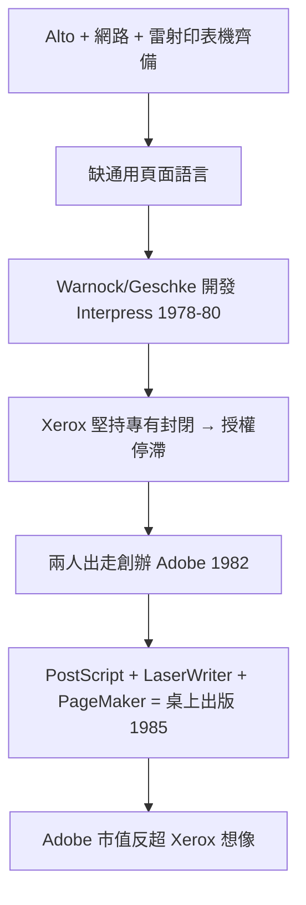

# 3.3 Interpress 與 PostScript 的淵源（1980-1982）

有了 Alto（內容來源）、乙太網路（傳輸）、雷射印表機（輸出），還缺一種**描述頁面的通用語言**——否則每台電腦與每台印表機都要為彼此客製驅動。John Warnock 與 Chuck Geschke 在 PARC 主持開發了 Interpress：第一套裝置無關的頁面描述語言（page description language），用堆疊式指令描述文字、向量圖形與影像，印表機只需解譯同一種格式。

Interpress 在技術上領先，卻死於商業決策：Xerox 堅持把它列為專有標準、只許自家印表機使用，且授權談判曠日廢時。Warnock 與 Geschke 認為，頁面語言必須像紙張一樣中立開放，才能成為產業標準。1982 年兩人離職創辦 **Adobe**，把 Interpress 的思想重寫為 PostScript；1985 年搭配 Apple LaserWriter 與 Aldus PageMaker，引爆桌上出版（desktop publishing）革命。

這是 PARC 外溢模式的經典案例：Xerox 擁有專利與原型，卻把標準封閉起來；出走者把同一思想開放化，反而做成更大的生意。Interpress→PostScript 的血緣，連指令集的堆疊機制都如出一轍。Xerox 後來只能眼看 Adobe 與 Apple 瓜分自己種下的果實。

### 因果鏈
系統三件套齊備暴露互通缺口 → Interpress 填補缺口 → 封閉策略扼殺標準機會 → 人才帶思想出走 → 開放的 PostScript 在外部生態（Apple）中引爆。技術因果鏈完整走通了，只是利潤結算發生在別家公司——這正是第 4 章人才出走潮的預演。
