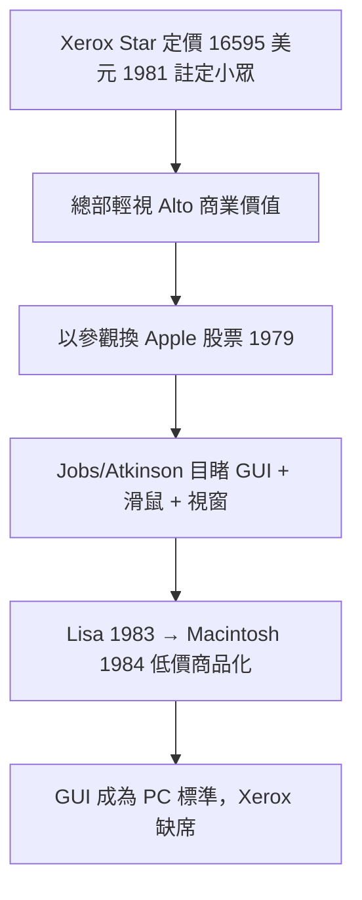

# 4.1 賈伯斯參觀與 Lisa、Macintosh（1979-1984）

1979 年 12 月，Apple 創辦人 Steve Jobs 率工程師造訪 PARC。這不是偶然：Xerox 為換取 Apple 上市前的 100 萬美元股票（約 10 萬股），同意向 Apple 開放 PARC 技術展示。Larry Tesler 與 Adele Goldberg 向訪客演示了 Alto 的 Smalltalk、重疊視窗、滑鼠操作與網路。Jobs 當場激動大喊：「你們坐在金礦上！」比爾·阿特金森（Bill Atkinson）回憶，離開停車場時他確信「每台電腦都會這樣工作」。

Apple 的 Lisa（1983）與 Macintosh（1984）幾乎是 Alto 的商品化轉世：位元映射螢幕、滑鼠、視窗、圖示、選單。差別在於取捨——Jobs 砍掉網路、砍掉高價硬體，用 $68000$ 處理器與 128K 記憶體把價格壓到 2495 美元，並補上 PARC 缺乏的東西：**行銷、工業設計與開發者生態**。Xerox 事後抗議抄襲，但法律上 GUI 概念不受專利嚴密保護，Xerox 自己也從未認真商品化 Alto（1981 年的 Xerox Star 定價 16595 美元，注定小眾）。

因果上最諷刺的是：Xerox 總部安排這場參觀，是為了向 Apple「展示實力」以合理化投資；結果卻把十年領先拱手送人。Alto 需要的只是一家願意把它賣便宜、賣漂亮的公司——而那家公司恰好姓 Apple。

### 因果鏈
Star 高價證明總部不懂個人電腦 → 輕視使參觀授權輕易放行 → Jobs 具備商品化嗅覺與執行力 → Apple 補上 PARC 缺的價格、設計與行銷 → GUI 在外部引爆。PARC 發明未來，Apple 發明「賣未來的生意」。
