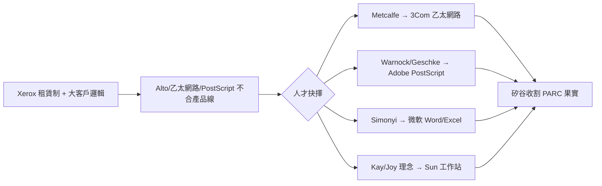

# 4.2 人才出走：Adobe、3Com 與 Sun（1979-1982）

1979-1983 年是 PARC 的大失血期，幾乎每項核心技術都帶走了一家公司。Robert Metcalfe 1979 年離開創辦 **3Com**，把乙太網路變成 PC 時代的連網標準，1990 年代市值一度超過 Xerox 本體；John Warnock 與 Chuck Geschke 1982 年創辦 **Adobe**，PostScript 與後來的 PDF 統治數位出版；Charles Simonyi（Bravo 之父）1981 年投奔微軟，主持 Word 與 Excel 開發，把所見即所得帶給 DOS/Windows 世界；Alan Kay、Bill Joy 等人則參與或 catalyze 了 **Sun Microsystems**（1982）的 workstation 理念——「網路即電腦」正是 PARC 分散式哲學的回聲。

出走的原因高度一致：Xerox 的產品決策流程以影印機邏輯運作——要求大客戶、大單價、租賃制，而 Alto、乙太網路、PostScript 都是**低單價、高銷量、開放生態**的生意。Lampson 的總結一針見血：「Xerox 只想要能租給大公司的機器，而我們在造人人買得起的東西。」Taylor 無力阻擋，1983 年黯然離開，CSL 黃金團隊就此解體。

人才流失與技術外溢是同一枚硬幣：Xerox 付了研究帳單，矽谷新創收了商業果實。用創投的語言說，PARC 是全世界回報率最高的「非自願育成中心」。

### 因果鏈
影印機商業模式決定產品審美 → 個人化、開放式技術全被判「不合適」→ 研究員帶技術與願景出走 → 同一技術在創業公司的生態位（低價、開放）中成功 → 反證 Xerox 誤判的不是技術，而是商業模式。人才流失是果，模式錯配才是因。
