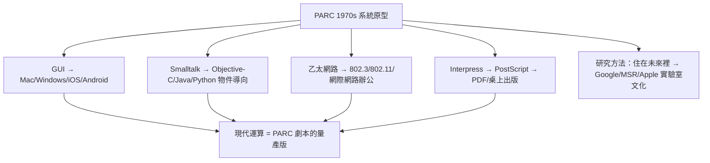

# 5.3 對現代運算的深遠影響

今天你手中的每一台裝置都是 PARC 的幽靈合唱：筆電的視窗與滑鼠（經觸控板轉世）、手機的重疊式 UI 與物件導向 App（Smalltalk→Objective-C→Swift 譜系）、辦公室的 Wi-Fi 與交換器（乙太網路的無線子孫，連 CSMA 思想都保留在 $802.11$ 退避演算法中）、印表機的 PDF（Interpress→PostScript→PDF 直系血親）。連「上網查郵件、開文件、列印」的整套辦公流程，都是 PARC 在 1975 年就排練過的劇本。

更深的遺產是方法論：PARC 證明了**系統級原型**的力量——不是發一篇論文、做一個零件，而是把「人+機器+網路+輸出」整套未來搬進一棟樓，讓一百個研究員每天住在裡面用它工作。這種「住在未來裡」的研究風格，被 Google、微軟研究院、Apple 完整繼承。Taylor 的 Dealer 會議、Kay 的「預測未來不如發明未來」（The best way to predict the future is to invent it），至今仍是實驗室文化的格言。

評價 PARC，終須回到起點：沒有影印機的獨占利潤，就沒有這場十年盛宴；沒有總部的誤判，這場盛宴也不會外溢為整個產業。Xerox 輸掉了公司戰爭，卻贏得了歷史地位——以一家公司的虧損，換來一個時代的作業系統。

### 因果鏈
獨占利潤養實驗室 → 實驗室造系統原型 → 原型經人才出走播種四方 → 每一粒種子長成一個產業（GUI、網路、出版、物件導向）→ 方法論本身成為遺產。PARC 的因果鏈從未斷裂，只是結算地點從羅徹斯特搬到了全世界。
