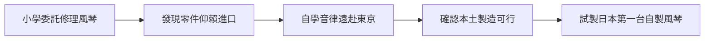

# 1.1 修琴匠山葉寅楠

山葉寅楠（1851-1916）出身紀州藩，早年跟隨兵器工匠學習木工與金屬加工，後來在濱松擔任醫療器械修理技師。1887年，濱松尋常小學委託他修理一台損壞的風琴。當時日本完全仰賴進口樂器，修理者甚至必須依賴進口零件，山葉寅楠在沒有圖紙的情況下憑藉自學與音感完成了修理，卻也發現音準不佳的問題，於是遠赴東京向音樂教師學習音律，最終判斷自己的成品合格。

這次修理看似小事，卻是整個企業史的起點：它讓山葉寅楠確認了三件事——日本有本土製造樂器的需求、自己的木工技術可以轉用於共鳴箱體、音準可以透過學習與標準化克服。他隨後與裝幀工匠河合喜三郎等人合作，在同年試製成功第一台日本自製風琴。

**因果分析**：修琴需求是「因」，本土製造的決心是「果」。若濱松小學沒有那台壞風琴，山葉寅楠可能終身是醫療器械技師。而「修理中的失敗與再學習」驅動了他對品質標準的執著，這份執著後來成為YAMAHA企業文化的原型——遇到問題不是退縮，而是把問題轉化為學習曲線。木工技術源自兵器與器械修理，這一技術根源也預示了公司日後「以同一技術母體，衍生多種產品」的多元化邏輯。

## 下一節
* [1.2 日本樂器製造合名會社的誕生](01.2-日本樂器製造合名會社的誕生.md)
