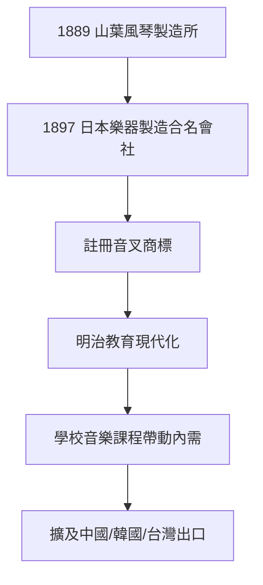

# 1.2 日本樂器製造合名會社的誕生

1889年（明治22年），山葉寅楠與山葉砥、山葉秀等人共同出資，成立了「山葉風琴製造所」，這是YAMAHA的正式前身。1897年，公司改組為「日本樂器製造合名會社」，並於同年向濱松稅務署登記，開始以有限公司形式經營。公司同時註冊了「音叉（Tuning Fork）」商標，這個源自音律標準的符號，日後成為全球認知的YAMAHA品牌標誌。

當時的日本正處於明治現代化中期，西方音樂隨新式教育體系進入學校課程，音樂教學用的風琴與鋼琴需求急速成長。日本樂器製造精準抓住這一波「教育制度化帶動的內需」，先後在東京、名古屋等地設立銷售據點，並在1900年左右取得中國、韓國、台灣的出口訂單，為後來的全球化埋下伏筆。

**因果分析**：「明治教育制度化」是需求側的因，「本土製造與出口」是供給側的果。若沒有明治政府將音樂納入小學課綱，日本樂器製造即使技術成熟，也難以迅速擴張。音叉商標的註冊則是另一個關鍵因果節點——它把「音準」這一技術承諾轉化為品牌資產，使公司在日後面對競爭時，能以「音的品質」作為差異化基礎。合名會社的改組則顯示公司從家庭工坊走向制度化的決心，為資本擴張與海外市場鋪路。

## 下一節
* [1.3 第一架國產鋼琴與早期出口](01.3-第一架國產鋼琴與早期出口.md)
