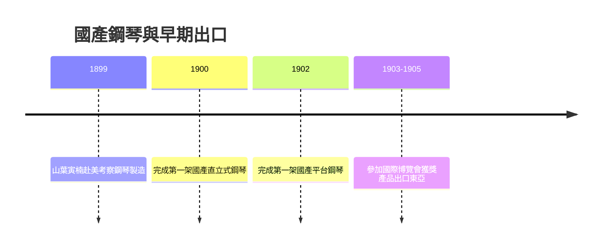

# 1.3 第一架國產鋼琴與早期出口

1900年，日本樂器製造完成了第一架國產直立式鋼琴「山葉鋼琴」。此前日本完全仰賴歐美進口，鋼琴價格高昂且維修不便。山葉寅楠聘請了曾留學美國的技術顧問，並親自前往美國觀摩鋼琴製造技術，將擊弦機構、音板調整與鑄鐵框架等關鍵技術逐步引進濱松工場。1902年，公司更成功製造出第一架國產平台（三角）鋼琴。

鋼琴的成功不僅是技術突破，更是產業鏈的建立：鋼琴需要木材、鑄鐵、毛氈、鍵盤等上百種零件，日本樂器製造因此培育出一整條本土供應鏈，也奠定了日後「以精密木工與金屬加工為核心能力」的技術母體。1903年前後，公司開始參與國際展覽並獲獎，產品逐步進入東亞與南洋市場，成為日本「製造業出口」的先驅之一。

**因果分析**：考察美國是「因」，國產化是「果」；國產化又是「因」，供應鏈與出口是「果」。山葉寅楠沒有停留在風琴的既有成功，而是以鋼琴——當時技術密度最高的樂器——作為公司能力的天花板測試。這種「以最難產品鍛鍊核心能力」的策略，成為YAMAHA企業史中反覆出現的驅動模式：鋼琴鍛鍊了木工與精密機械，木工與精密機械後來又衍生出摩托車與電子樂器。出口的成功則讓公司早於同業建立「品質對標國際」的標準意識。

## 下一節
* [2.1 株式會社改組與濱名橋工場時代](02.1-株式會社改組與濱名橋工場時代.md)
